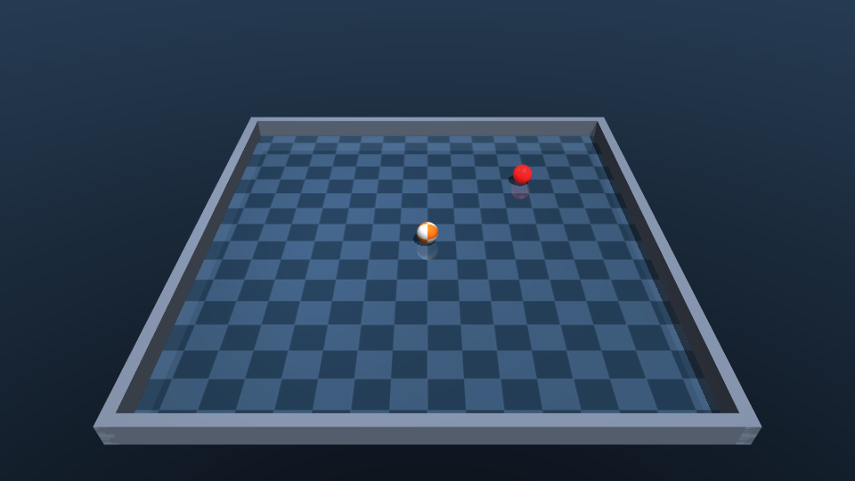
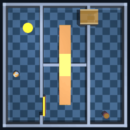
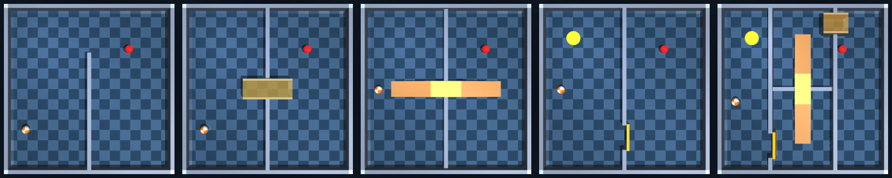

# Modular Sphere

[](https://github.com/mcaniot/modular_sphere/actions/workflows/ci.yml)
[](https://codecov.io/gh/mcaniot/modular_sphere)


[](https://github.com/astral-sh/ruff)
[](LICENSE)

MuJoCo simulation of a spherical robot and a test bench for *world models* (learned dynamics
models) on a deterministic Gymnasium environment.

<p align="center">
  
  
</p>

Detailed architecture: [`docs/architecture.html`](docs/architecture.html). Regenerate the
illustrations with `MUJOCO_GL=egl uv run python docs/make_figures.py`.

## Installation

```bash
uv sync --extra dev                   # or: pip install -e ".[dev]"
uv sync --extra dev --extra torch     # + PyTorch MLP world model
uv sync --extra dev --extra filament  # + Filament PBR renderer (needs Python >= 3.12)
```

Python ≥ 3.11 (MuJoCo 4). Classic offscreen rendering: `MUJOCO_GL=egl` (GPU) or
`MUJOCO_GL=osmesa` (CPU, package `libosmesa6`). Videos are encoded to H.264 by `imageio` with
the ffmpeg binary bundled by `imageio-ffmpeg` (no system ffmpeg needed).

## Usage

```bash
# Interactive control
uv run modular-sphere teleop                                   # arrows = force, N = new goal

# Data collection
uv run modular-sphere collect --out data/train.npz --episodes 200 --seed 0
uv run modular-sphere collect --out data/eval.npz  --episodes 50  --seed 10000

# Course data collection (levels 1-5)
uv run python -m modular_sphere.tools.collect_courses --all-levels --episodes 100 --out-dir data/courses

# World model evaluation
uv run modular-sphere eval-wm --model linear --train-data data/train.npz --eval-data data/eval.npz
uv run modular-sphere eval-wm --model mlp    --train-data data/train.npz --eval-data data/eval.npz

# GUI evaluation
uv run python -m modular_sphere.tools.eval_gui              # basic reach in the MuJoCo viewer
uv run python -m modular_sphere.tools.eval_gui --level 1    # course L1
uv run python -m modular_sphere.tools.eval_gui --level 1 --model models/mlp_world_model_course_l1.pt  # trained model
uv run python -m modular_sphere.tools.eval_gui --record demo.mp4  # record a video

# Video rendering
uv run modular-sphere record --out demo.mp4 --renderer filament --camera overview
```

### Rendering

- `classic`: `mujoco.Renderer` (OpenGL), also used for `render_mode="rgb_array"`.
- `filament`: MuJoCo 4 physically based rendering (PBR) via `mujoco.rendering.filament`, following
  the [MuJoCo Python docs](https://mujoco.readthedocs.io/en/latest/python.html). Requires
  Python ≥ 3.12 (MuJoCo 4.0.1 imports `collections.abc.Buffer`, missing in 3.11) and an X display:
  a GPU session, or Mesa llvmpipe under `xvfb-run` without GPU. Video export only; image
  observations stay on the classic renderer. Lighting is set by the `filament.fallback.*`
  `<numeric>` entries of `sphere_arena.xml`.

```python
import gymnasium as gym
import modular_sphere

env = gym.make(modular_sphere.ENV_ID)  # "ModularSphere/Reach-v0"
# Image observations: gym.wrappers.AddRenderObservation(gym.make(..., render_mode="rgb_array"))
```

### Obstacle courses

`ModularSphere/Course-L{1..5}-v0` (`modular_sphere.courses.SphereCourseEnv`): same sphere, same
action, goal drawn in the finish zone (x ∈ [1.4, 1.9] m), levels built on the arena with
`mujoco.MjSpec`, increasing difficulty:


*`top` view of levels L1 to L5: sphere (orange), goal (red), plate (yellow), bridge (light
orange), tunnel (brown).*

| Level | Obstacle | Max steps |
| --- | --- | --- |
| L1 | wall to go around through a side opening | 200 |
| L2 | only passage: 0.4 m × 0.26 m tunnel | 200 |
| L3 | unclimbable low wall, 0.4 m wide bridge on 10° ramps (falls are recoverable) | 250 |
| L4 | floor plate (latched once pressed) that opens a sliding door | 300 |
| L5 | plate + door, bridge, then tunnel | 600 |

13-D observation: the 11 base components, `button` (0/1) and `door` (opening 0–1).
`WaypointPolicy` (PD on waypoints) solves every level; zero, random and straight-to-goal actions
fail (`tests/test_courses.py`).

### Swarm step climb (3D, multi-agent)

`modular_sphere.swarm.SphereSwarmStepEnv` (PettingZoo `ParallelEnv`, factory `parallel_env`):
`n_spheres` (default 4, ≥ 2) copies of the sphere must **all** gather in a zone (red disc, radius
`0.2 √N` m) on a platform behind a 0.15 m step (x ≥ 0.5 m), like ants building a living ramp. The
step is higher than the sphere radius, so no sphere can climb it alone, and the last sphere needs
a partner already on the platform to pull it up. Arena walls are raised to 0.5 m.

- Action per agent `[fx, fy, lift, attach]` in [-1, 1]: world-frame x, y force in N (as in the
  base contract), internal vertical force `lift × 6 N`, and a link request (`attach > 0`).
- Attachment: two spheres whose surfaces are within 2 cm link when both request it and stay linked
  while both keep requesting it. A link fixes the distance between the centres (ball-joint like):
  each sphere can orbit around the other.
- Lift is internal: the opposite force is split over the linked partners, so a lone sphere cannot
  lift itself, but a sphere can pivot over a linked partner.
- Local observation (world frame): `pos`, `vel`, `ang_vel`, `goal_rel` (3-D), then for each other
  sphere in cyclic order relative position, relative velocity and linked flag
  (`swarm.obs_slices(n)`); `state()` gives the global state for centralised critics.
- Shared reward: progress of the mean sphere-goal 3D distance, step penalty, success bonus when
  every sphere is on the platform inside the zone (`info["n_arrived"]` counts them); episodes last
  `150 × N` steps.
- `SwarmClimbPolicy` (scripted, centralised) solves it: a base sphere holds against the step, the
  others climb over it one by one, and the last climber pulls the base up from the platform edge.

```python
from modular_sphere.swarm import SwarmClimbPolicy, parallel_env

env = parallel_env(n_spheres=4)
policy = SwarmClimbPolicy(4)
obs, infos = env.reset(seed=0)
while env.agents:
    obs, rewards, terminations, truncations, infos = env.step(policy.act(obs))
```

#### Learning the swarm climb (world model + action learning)

The scripted policy is then learned from state (extra `torch`), with one command:

```bash
uv run python -m modular_sphere.tools.train_swarm --spheres 4 --out-dir data/swarm
```

1. `swarm_data.collect`: expert episodes with DART noise (noisy execution, clean labels).
2. `SwarmPolicy`: one decentralised network shared by all spheres (Deep Sets over the others),
   behaviour cloning then DAgger rounds where the learner drives and the expert relabels.
3. `collect(random_prob=...)`: exploration episodes where spheres hold random actions, then an
   ensemble of `SwarmWorldModel` (interaction network over spheres with distances to the walls and
   the step, per-sphere state delta and next links, unrolled multi-step loss) on all real data;
   reward and success are computed from the predicted state.
4. `improve_with_ppo`: PPO on rollouts of the frozen ensemble (MAPPO-style centralised critic,
   team reward with a time penalty for speed, KL to the DAgger policy, ensemble-disagreement
   penalty), run in chunks; the chunk with the best MuJoCo speed on separate selection seeds is
   kept. `improve_in_imagination` (gradients through the model) remains available but exploits
   the model on this task.
5. Every policy is evaluated in MuJoCo on the same held-out seeds; `report.json` holds success,
   the speed objective `speed_vs_expert` (expert steps / policy steps on success, 0 on failure)
   and an exact McNemar test between the DAgger and PPO policies.

Status (N = 4, 50 test seeds): DAgger and PPO both succeed on 47/50 (McNemar p = 1). PPO is faster:
`speed_vs_expert` 0.919 -> 0.942, and on the 45 seeds both solve it needs 246.5 instead of 253.5
steps on average, faster on 42 and slower on 1 (exact sign test p < 1e-4).

#### MOSAIC: skills, skill world models and a parallel scheduler

Courses: `swarm.Course` (step faces and rises) and `random_course` (1 to 3 steps) through the
`course` option of `SphereSwarmStepEnv` (default: the single step, so default episodes are
unchanged). MOSAIC splits the climb into three skills (roll, climb, pull). Each skill has a small
world-action model (`swarm_wam.SkillWAM`), trained on scripted skill data and on skill-chaining
data. A scheduler (`swarm_plan.SkillScheduler`) runs the skills in parallel lanes over subsets of
spheres. It chooses the plan by the makespan predicted with steps-to-go effect models
(`SkillValue`), replans level by level, and pulls back up any sphere that fell off the platform.
Each skill call carries the frame of its step, so skills learned on one step run on any course.

Results (paper: [`docs/paper/skill_world_models.md`](docs/paper/skill_world_models.md), 50 seeds,
exact McNemar on success and sign test on steps against the expert):

- **Test seeds (one step, N = 4):** 50/50 like the expert, in 147 steps against 248.
- **Unknown random courses:** 50/50 like the expert, in about half the expert's steps.
- **Fresh perturbed courses:** with a normalisation floor, training on noisy inputs, and chain data
  with randomised mass, friction and rise mixed with the nominal data, MOSAIC matches the
  expert's success in seven of nine conditions, at about half its steps. The conditions are
  friction ×0.5 and ×1.5, mass ×1.5, rise 0.10 m and N = 5 or 6.
- **Energy-shaped pull:** the skills' pull meters the lift by the base's specific energy
  (energy-based swing-up, mass-free) instead of full lift, which dragged light helpers off the
  edge. Retrained on its labels, MOSAIC solves 50/50 with spheres 30 % lighter (2/50 before) and
  matches the expert in seven of nine conditions on fresh courses, always faster.
- **Open limits:** under 5 mm of sensor noise MOSAIC solves 42/50 and with spheres 50 % heavier
  44/50, against 50/50 for the expert.

## Simulation contract

| Item | Value |
| --- | --- |
| Physics | MuJoCo, 2 ms timestep, `implicitfast` integrator |
| Control | `frame_skip=25` → 20 Hz (`dt = 0.05 s`), episode truncated at 200 steps (10 s) |
| Action (2) | world-frame x, y force in N, bounded to [-1, 1] |
| Observation (11) | `pos` x,y,z [m] · `vel` x,y,z [m/s] · `ang_vel` x,y,z [rad/s] · `goal_rel` x,y [m], all in the world frame (`OBS_SLICES`) |
| Sphere | radius 0.10 m, mass 0.300 kg, solid-sphere inertia, viscous damping 0.69 N·s/m in x/y |
| Arena | 4 × 4 m enclosed by walls |
| Goal | visual sphere without collision, \|x\|, \|y\| ∈ [0.5, 1.0] m, random signs |
| Reward | `(d_prev − d) − 0.01 + 10·success`; `terminated` when `d < 0.2 m` (the two spheres touch) |

The observation is the full Markov state of the dynamics (the sphere is symmetric, its
orientation does not affect the physics): `MuJoCoOracleModel` replays the simulation from an
observation and is the zero-error reference (< 1e-6).

## Testing a world model

A model implements `rollout(obs0 (B, 11), actions (B, H, 2)) -> (B, H, 11)` and, if it learns,
`fit(dataset: TrajectoryDataset)`. Pass it to the CLI with `--model modular_sphere.module:factory`
(zero-argument factory); for safety, only modules of the `modular_sphere` package can be
imported.

`eval-wm` computes the open-loop RMSE for each horizon and each observation group over sliding
windows of the evaluation set. Provided references: `oracle` (ground truth), `linear` (ridge
regression on deltas), `constant-velocity` (no physics), `mlp` (`torch` extra).

`MLPWorldModel` (`modular_sphere.torch_world_model`) follows the one-step dynamics model of PETS
(Chua et al., 2018) and MBPO (Janner et al., 2019): a SiLU MLP predicting the normalized delta
`obs[t+1] − obs[t]`, trained with MSE (AdamW, cosine schedule), rolled out autoregressively;
`save`/`load` as a PyTorch checkpoint. Deviation from these references: a single deterministic
network, no probabilistic ensemble. Libraries ruled out: `mbrl-lib` (frozen in 2023 on
`gymnasium==0.26.3`) and `torchrl` world models (designed for TensorDict latent spaces).

Datasets (`.npz`) hold fixed-length episodes that are not cut at success, half
Ornstein-Uhlenbeck noise, half noisy PD controller towards the goal.

## Validation

`uv run pytest --cov` (100 % line and branch coverage, published to Codecov by CI): Gymnasium API,
determinism, exact oracle, physics against the analytical rolling model (terminal velocity F/c,
time constant 1.4 m/c, error < 2 %), timestep convergence, penetration and speed bounds on
impacts, negative controls, classic and Filament rendering (skipped without an X display), MP4
export, MLP world model (skipped without PyTorch), tools and error paths.

## Extra tools

### Course data collection

`modular_sphere.tools.collect_courses` collects data for the 5 course levels:

```bash
# All levels
uv run python -m modular_sphere.tools.collect_courses --all-levels --episodes 100 --out-dir data/courses

# One level
uv run python -m modular_sphere.tools.collect_courses --level 3 --episodes 200 --out-dir data/courses
```

Options: `--level 1-5` or `--all-levels`, `--episodes N` (default 50), `--steps N` (default: the
level's `max_steps`), `--seed S` (level L: `S + 1000·L`), `--goal-seeking-ratio R` (default 0.5).
Output: `<out-dir>/course_l<L>.npz`.

### GUI evaluation

`modular_sphere.tools.eval_gui` evaluates world models visually in the MuJoCo viewer:

```bash
# Basic reach environment
uv run python -m modular_sphere.tools.eval_gui

# Course level 1-5
uv run python -m modular_sphere.tools.eval_gui --level 1

# With a trained model
uv run python -m modular_sphere.tools.eval_gui --model models/mlp_world_model.pt

# Record a video
uv run python -m modular_sphere.tools.eval_gui --record demo.mp4

# Policies (default: waypoint on courses, pd on reach)
uv run python -m modular_sphere.tools.eval_gui --policy pd          # PD controller towards the goal
uv run python -m modular_sphere.tools.eval_gui --policy random      # random actions
uv run python -m modular_sphere.tools.eval_gui --level 2 --policy waypoint  # scripted pilot
```

Options: `--level 0-5` (0 = reach), `--model PATH`, `--policy pd|random|waypoint`, `--steps N`
(default 600), `--horizon H` (default 20 steps, ghost re-anchoring), `--seed S`, `--record PATH`.

The translucent blue ghost shows the model's open-loop prediction from the last real state; the
position error is printed at each re-anchoring. Get a `.pt` model with
`MLPWorldModel().fit(TrajectoryDataset.load("data/courses/course_l1.npz"))` then `.save(path)`.

## Migration from the PyBullet version (0.0.2)

PyBullet/qibullet, the `stable_baselines` PPO2 agent (TensorFlow 1) and its pretrained model are
removed. Contract changes: fixed deterministic timestep instead of a real-time thread, reward
independent of the wall clock, 11-D Markov observation instead of 6-D positions, non-physical
goal, walls instead of a failure beyond 2 m, realistic inertia instead of `I = 1 kg·m²`.

## License

See `LICENSE`.
