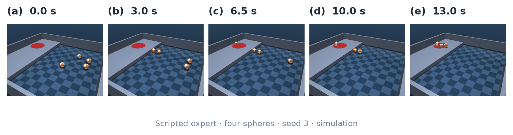
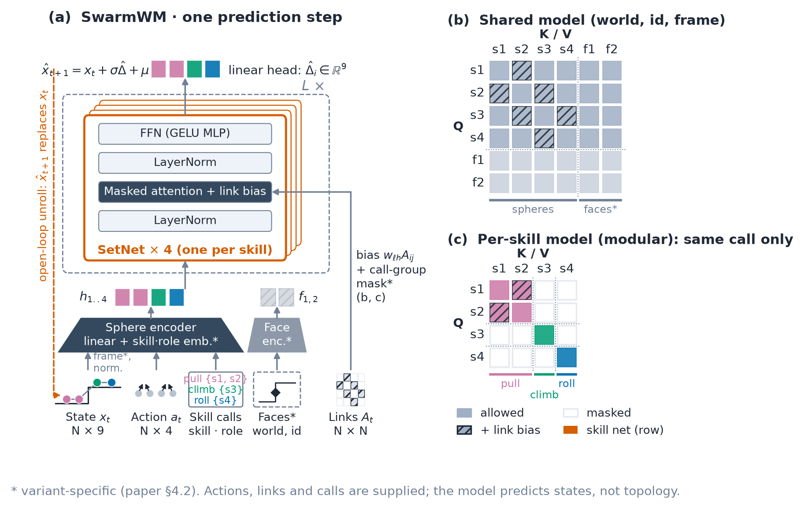
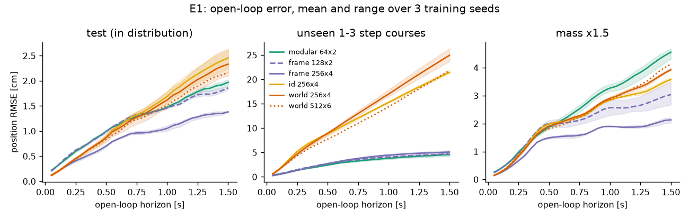
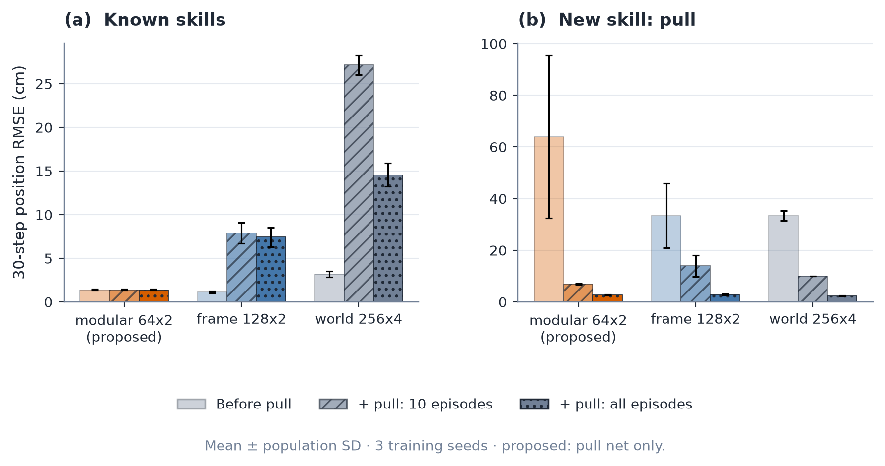
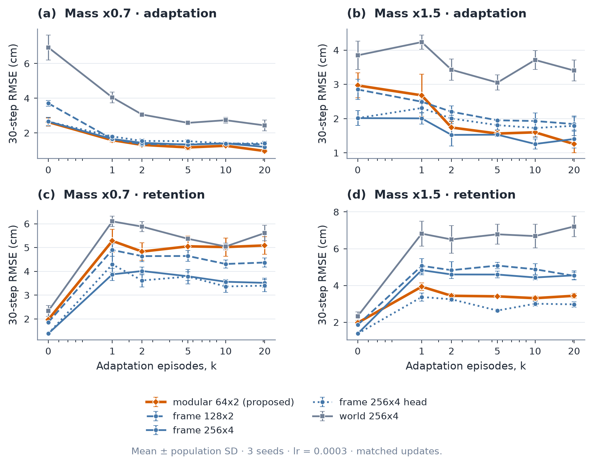
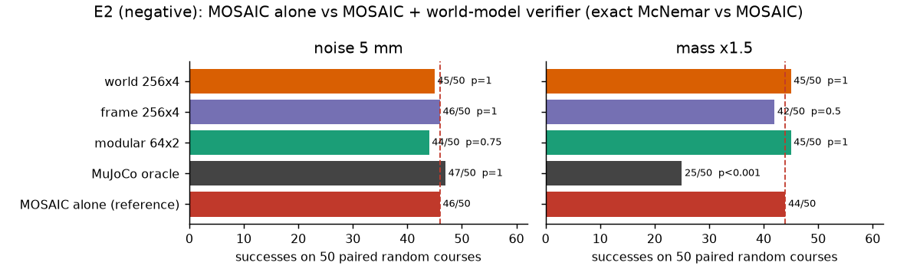
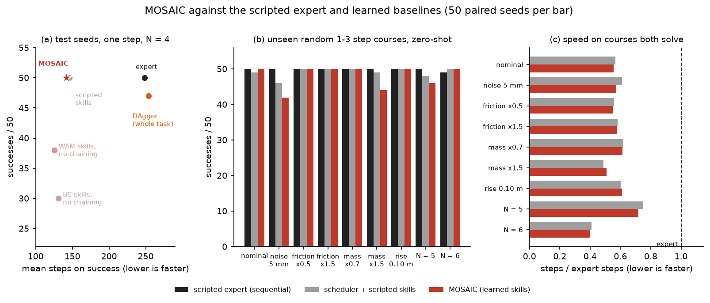

# Skill-frame world models: linked-sphere generalisation and frozen-expert skill addition

*Working paper, revised 2026-11-25. Code inspected at commit
`40fb440d0935d987aa7bfb2c19b89d2c84aa004e` of this repository (Appendix C).
Reported runs are listed in Appendix C; results marked **preliminary** use too few episodes for
a conclusion. This text revision adds no training runs.*

## Abstract

Learned world models for modular robots must handle changing roles, links and layouts. We study
a MuJoCo swarm of rolling spheres that link to climb a step that no sphere can climb alone.
MOSAIC combines a parallel skill scheduler with learned imitation executors; separately, we compare
four swarm dynamics models on the same data. Their continuous-state predictions are autoregressive,
conditioned on recorded actions and future link/call context. The skill-call representation
(position translation plus call-specific geometry/context) gives about five times lower 30-step
error on unseen courses than world-frame models of up to 19 M parameters. This comparison does not
isolate translation from the changed geometry inputs. Equal-size modular and shared framed models
have similar measured errors, without an equivalence test. With task-labelled routing, freezing old
experts and normalisation gives 0.0 cm forgetting when adding pull, versus +6 to +24 cm for shared
models fine-tuned without replay or regularisation. Mass-endpoint adaptation within the training
marginal randomisation range shows no consistent modular advantage over a large framed model.
Action-chunk verification shows no statistically detectable success improvement under the tested protocol,
including with MuJoCo dynamics; the oracle verifier degrades success in the heavy-mass condition.
Most dynamics comparisons use three training seeds; the 19 M-parameter model uses one.

## 1. Introduction

Modular and swarm robots can solve together what each one cannot, but the coordination is hard to
learn: the reward is sparse and delayed, the useful actions (link, lift) only matter in rare
configurations, and the joint action space grows with the number of agents. Self-assembling agents
that learn to link through reinforcement learning were shown by Pathak et al. [12], in simulation
and with a dense locomotion reward. Here the question is narrower and practical: given a scripted
solution, can a learned model of the world **choose the actions** (instead of only imitating
them) and find faster, more parallel strategies?

A world model of such a swarm has to answer a different question from the one it answers for a
single agent: which parts of the model must be shared across skills and scenarios, and which can be
separated? We compare one large world model with several small ones, one per skill, on the same
data, and ask which design predicts well on courses and dynamics outside the training distribution,
and which one allows a new skill to be added without damaging what the model already knows.

*Figure 1. The task: four linked spheres must all reach the red zone on the platform; the step is
1.5 radii high (scripted expert, seed 3, 259 steps). Panels (a–e) are evenly sampled simulation
snapshots, labeled with their actual simulation times, not learned-model predictions.*

Contributions:

1. **A skill-call representation that transfers to unseen courses.** Position translation together
   with call-specific geometry/context gives about five times lower 30-step error than the tested
   world-frame models, including a 19 M-parameter model. Translation alone is not isolated;
   equal-size modular and shared framed models have similar measured errors, not established
   equivalence (Section 5.1).
2. **Task-labelled skill addition with frozen experts.** Training only the new pull network while
   freezing old experts and normalisation gives 0.0 cm forgetting, versus +6 to +24 cm for shared
   models fine-tuned without replay or regularisation (Section 5.2).
3. **Protocol-specific neutral and negative results.** There is no consistent modular advantage in
   mass-endpoint adaptation (Section 5.3), and no statistically detectable success improvement from
   the tested verifiers; the heavy-mass oracle verifier degrades success (Section 5.4).
4. **MOSAIC and its benchmark.** A deterministic MuJoCo benchmark with a scripted expert, parallel
   scheduling, steps-to-go effect models and learned imitation executors evaluated zero-shot on
   fresh random courses (Section 3, Section 4.4 and Appendix A).

## 2. Related work

All references were checked against arXiv metadata on 2026-11-21.

- **Learned dynamics over objects and relations.** Interaction networks [1] model a system as a
  graph of objects and relations; our world model is a small interaction network over spheres with
  link flags as edge features.
- **Imitation with corrective data.** DAgger [2] reduces covariate shift by labelling the learner's
  own states with the expert; DART [3] injects noise into the executed expert actions while keeping
  the clean labels. We use both.
- **Policy improvement inside a learned model.** ME-TRPO [4] trains a policy on an ensemble of
  learned models to limit exploitation; we observed the same exploitation (Appendix B). PPO [5] with
  GAE [6] and its multi-agent variant with a centralised critic, MAPPO [7], are our RL baselines.
- **Planning with learned models.** MPPI [8] samples action sequences and averages them with
  exponential weights on the predicted cost. TD-MPC [9] and TD-MPC2 [10] plan with MPPI in a learned
  latent model and add samples from a learned policy; MoDem [11] starts this loop from
  demonstrations. Our skill planner follows this design (Appendix A.2.7).
- **Skills and their models.** DADS [13] learns skills together with skill-conditioned dynamics
  for planning; SkiMo [14] learns a skill-level dynamics model and plans over skills; Liang et al.
  [15] learn per-skill *effect models* (outcome and cost of executing a skill from a state) and
  compose skills by graph search; Silver et al. [16] learn skills with symbolic preconditions and
  effects for bilevel planning. MOSAIC combines learned imitation executors with effect-model
  scheduling over **variable subsets of agents** whose links change. Dynamics-based low-level action
  choice is a separate, unsuccessful planning study (Appendix A.6), not the deployed executor.
  Abstract-level comparisons do not establish novelty of this combination; full-text comparison
  with the closest systems remains open.

- **Modular and compositional world models, continual learning.** Zhou et al. [33] benchmark world
  models for continual learning on compositional tasks; the Prismatic World Model [34] learns
  compositional dynamics for planning in hybrid systems; Mixture-of-World Models [35] scales
  multi-task reinforcement learning with modular latent dynamics. Our modular model uses supplied
  skill labels and four separate networks, not a learned gate or shared dynamics backbone.
  Section 5 compares our implemented variants, not reproductions of these prior systems; full-text
  mechanism and baseline comparisons remain future work.

## 3. Setting

### 3.1 Environment

`SphereSwarmStepEnv` (`src/modular_sphere/swarm.py`), MuJoCo [17] physics (4.0.1), PettingZoo [18]
parallel API.

*Table 1. Simulation contract for the linked-sphere benchmark.*

| Item | Value |
|---|---|
| Spheres | N = 4 by default (2 to 6 tested), radius 0.10 m, mass 0.30 kg |
| Physics / control | timestep 2 ms, frame skip 25 (20 Hz), implicit-fast integrator |
| Step | face at x = 0.5 m, height 0.15 m (1.5 radii); platform beyond |
| Action per sphere | `[fx, fy, lift, attach]` in [-1, 1]; force in N; lift up to 6 N (about twice the weight), internal: the reaction is split on linked partners |
| Links | tendon equality between centres; formed only if both spheres request it and the gap is ≤ 2 cm; broken if either releases |
| Success | every sphere on the platform within `0.2·sqrt(N)` m of the goal |
| Episode | 150·N steps; reward = progress of the mean distance − 0.01 per step + 10 on success |
| Determinism | same seed → same episode |

The scripted expert `SwarmClimbPolicy` places one base sphere against the step face; the others
climb over it one at a time (staging area, align, link, lift, release on top); the last one on top
pulls the base up from the edge. It succeeds on 80/80 seeds for N = 2, 3, 4, 6 (at most 396 steps at
N = 6). It is sequential: on seeds 200000–200004 at N = 4 it takes 227–270 steps and only 41–45 %
of sphere-steps have a horizontal speed above 5 cm/s.

### 3.2 Skills

`swarm_skills.py`. Three skills over subsets of spheres:

- `roll(i, target)`: sphere *i* rolls to an xy target on its current level;
- `climb(c, b)`: base *b* holds the face, climber *c* aligns behind it, they link, *c* lifts and
  goes over *b* onto the platform;
- `pull(h, b)`: helper *h* on the edge links with base *b* at the face, and *b* pivots up.

 Each skill has a scripted controller (pieces of the expert), a sampler of start states in its
initiation set and an event-based termination (target reached at low speed; climber on top; base
above the helper), following [16]. The skills are executed by scripted controllers, cloned policies
or world-action models (Section 4.4).

## 4. Method

### 4.1 Data

Data come from the scripted scheduler with its true call schedule recorded (`record_episode`).
The configured splits are 400 training episodes (seeds 0–399), 50 validation episodes
(300000–300049) and 50 test episodes (200000–200049). Seeds divisible by four use nominal dynamics
and rise; the others use a uniform rise in [0.10, 0.15] m, rounded to 1 mm, and uniform
factors of [0.7, 1.5] for mass/inertia and [0.5, 1.5] for sliding friction
(`modular_e1.py:condition`, `swarm_plan.py:perturb_dynamics`). The original test distribution is
mixed, not nominal-only. Rise and mass reuse the first draw from generators initialised with
the same episode seed, so their draws are coupled; these are marginal ranges, not independently
sampled joint support. DART action noise has standard deviation 0.05 when
`(seed // 4) % 2 == 1` (half the training episodes).

Each shifted evaluation set has 50 episodes, seeds 600000–600049: random 1–3-step courses, six
spheres, mass ×0.7, mass ×1.5, or rise 0.17 m. The mass conditions fix an endpoint of the training
marginal mass range, with other parameters nominal. They shift the joint condition but do not
extrapolate beyond the marginal mass range. Rise 0.17 m, course layouts and six-sphere configurations differ from training support. Earlier whole-task and
skill-level datasets are described in Appendix A.2.

### 4.2 Swarm world models

`swarm_modular.py` trains four model kinds on the same data, all set transformers over sphere tokens
with a learned link-attention bias (`SwarmWM`):

- `world`: world-frame states plus the course faces (the large monolith);
- `id`: `world` plus the skill and role of every sphere (the monolith with skill identity, as
  in skill-conditioned models such as SkiMo or TD-MPC2);
- `frame`: one shared net with translated positions relative to the executing call, skill/role
  identity and call rise instead of course-face tokens; idle positions translate to zero;
- `modular`: four nets (idle, roll, climb, pull) with exactly the `frame` inputs, each attending
  only to the spheres of the same call, routed by the executed call.

The per-sphere state is $x_i=[p_i,v_i,\omega_i]\in\mathbb{R}^9$: world-frame position,
linear velocity and angular velocity. For framed models, $\tilde{x}_i=[p_i-o_{c(i)},v_i,\omega_i]$;
otherwise $\tilde{x}_i=x_i$. Translation rotates neither axes nor velocities. Idle spheres use
their current position as origin. State and state-change statistics give

$$
z_i=(\tilde{x}_i-\mu_x)/\sigma_x,\qquad
\hat{x}_{i,t+1}=x_{i,t}+\sigma_\Delta d_i+\mu_\Delta.
$$

Here $d_i$ is the network's nine-component output; products/divisions are componentwise.
Statistics are fitted over valid first transitions of training windows and all spheres, using
PyTorch's sample standard deviation. State scales are floored at 0.01 and delta scales at 0.001
in their respective coordinate units, and remain frozen during E3 phase 2 and E4 adaptation.
Sphere tokens concatenate $z_i$ with four raw executed action components (13 dimensions), plus
call rise for framed models (14 dimensions). These variants change geometry/context encoding
as well as translation; they do not isolate a coordinate-transform effect.

All four predict continuous sphere state, not links or calls. In E1, E3 and E4, the unroll feeds
back predicted state while supplying recorded actions and future links, categories, origins,
rise and groups at each step (course faces are fixed). We call this **conditional open-loop**
or state-autoregressive prediction: it is not autonomous topology or schedule prediction.
Reward and success are computed analytically, not learned as prediction heads.

*Figure 2. SwarmWM in the style of transformer world models. (a) One prediction step: sphere
tokens (state, executed action and, for framed models, call rise, positions translated to the
skill-call frame) plus a skill·role embedding feed L = 2 pre-LN blocks (LayerNorm, masked
attention with a learned per-layer, per-head link bias $w_{\ell h}A_{ij}$, LayerNorm, GELU MLP);
a sphere-only linear head predicts the normalised 9-D state change. `modular` stacks four such
SetNets (idle, roll, climb, pull) and each sphere keeps the output of its call's net; `world` and
`id` add course-face tokens. The predicted state is fed back while recorded actions, links and
calls are supplied (8 steps for training, 30 for evaluation). (b, c) Attention masks for one
example (calls pull {s1, s2}, climb {s3}, roll {s4}; links s1–s2–s3–s4): shared models attend over
all spheres (and faces for `world`/`id`); the per-skill model attends only within a call, so the
s2–s3 link is masked. A fixed routing, not a learned mixture gate.*

### 4.3 Training and evaluation

Training uses 8-step state-autoregressive windows starting every two valid steps, 40 epochs and
training seeds 0–2 (`world_512x6`: seed 0 only). AdamW uses learning rate 3·10⁻⁴, weight decay
10⁻⁵, batch size 256, cosine decay over epochs and gradient-norm clipping at 1. For window $w$,
step $t$, sphere $i$ and state coordinate $j$, with valid-step mask $m_{wt}$, the loss is

$$
\mathcal{L}=
\frac{\sum_{w,t}m_{wt}\,\frac{1}{9N}\sum_{i,j}
[(\hat{x}_{wtij}-x_{wtij})/\sigma_{\Delta,j}]^2}
{\max(1,\sum_{w,t}m_{wt})}.
$$

Evaluation windows start every ten valid steps. At horizon $h$, each training run's position
RMSE is $100\sqrt{\operatorname{mean}_{w,i}\|\hat{p}_{w,h,i}-p_{w,h,i}\|_2^2}$ in cm,
excluding invalid steps. This averages squared Euclidean position norms, not per-axis RMSE;
valid sphere-window pairs are equally weighted, not episodes. The main horizon is 30 steps
(1.5 s). Tables report arithmetic means and population standard deviations (ddof = 0) of these
per-run RMSEs, unless noted. Paired comparisons use the same evaluation seeds.

The E1 report's pooled sphere-window sign tests ignore within-episode/window dependence and
shared training runs; they are exploratory, not confirmatory significance evidence. E4's
episode-cluster intervals and training-seed limitation are described in Section 5.3. Closed-loop
success uses exact McNemar tests [19]; non-rejection is not equivalence.

### 4.4 MOSAIC executors and world-action models

MOSAIC schedules the skills in parallel lanes over subsets of spheres, choosing roles and lanes by
the makespan predicted with per-skill steps-to-go effect models. Each skill call is executed by its
scripted controller, by a cloned policy or by a small world-action model (WAM) that jointly predicts
the next 10 skill frames and a 10-step action chunk from a 4-frame history, after GR00T 2 [20]. The
executors are trained on chain data, the skill calls of noisy scripted schedules started from the
end states of the preceding skills, and every call is expressed in the frame of its step. The system
results and its ablations are in Appendix A. These are imitation executors: predicted frames are
auxiliary training targets, not dynamics rollouts used to select the deployed action. On climb, the
same transformer without history, chunking or frame prediction reaches 50/50, while the widened
cloned MLP reaches 49–50/50 over three seeds (Section A.7). Those capacity controls do not establish
a benefit from the world-action ingredients.

## 5. Experiments

The overall question: do several small world models, one per skill, predict the swarm better than
one large model, and do they make adding a skill or a scenario cheaper? We split it into four
research questions. Q1 (E1): does the skill-call representation transfer? Q2 (E3): can a skill be
added without forgetting? Q3 (E4): does modularity help mass-endpoint adaptation? Q4 (E2): does a
world model help as a verifier of the WAM chunks? Tables report mean ± std over three training seeds
unless noted.

### 5.1 Q1: does the skill-call representation transfer? (E1)

**E1, accuracy (Table 2).** Conditional open-loop position RMSE at 30 steps (1.5 s), cm, mean ± std
over three training seeds (`world_512x6`: one seed):

*Table 2. E1 conditional 30-step position RMSE, cm; training-seed mean ± population SD.*

| Variant | Params | test | courses | N = 6 | mass ×0.7 | mass ×1.5 | rise 0.17 |
|---|---|---|---|---|---|---|---|
| modular 64×2 | 0.41 M | 1.97 ± 0.05 | 4.56 ± 0.22 | 4.99 ± 0.19 | 3.10 ± 0.21 | 4.56 ± 0.17 | 5.23 ± 0.38 |
| modular 128×2 | 1.6 M | 1.88 ± 0.08 | **4.17 ± 0.31** | 5.27 ± 0.26 | 2.86 ± 0.14 | 5.97 ± 0.55 | 4.90 ± 0.50 |
| frame 128×2 | 0.40 M | 1.86 ± 0.03 | 4.70 ± 0.10 | 4.10 ± 0.16 | 3.79 ± 0.18 | 3.04 ± 0.33 | 3.78 ± 0.11 |
| frame 256×4 | 3.2 M | **1.38 ± 0.01** | 5.09 ± 0.21 | **3.53 ± 0.08** | **2.69 ± 0.22** | **2.13 ± 0.07** | **2.87 ± 0.16** |
| id 256×4 | 3.2 M | 2.46 ± 0.15 | 21.4 ± 0.4 | 5.28 ± 0.07 | 5.19 ± 0.93 | 3.58 ± 0.07 | 3.77 ± 0.19 |
| world 256×4 | 3.2 M | 2.33 ± 0.23 | 24.9 ± 1.1 | 6.20 ± 0.34 | 6.91 ± 0.68 | 3.93 ± 0.04 | 4.13 ± 0.34 |
| world 512×6 | 19 M | 2.17 | 21.8 | 5.06 | 4.52 | 4.13 | 4.56 |

The skill-call representation package gives about five times lower error on unseen courses than
the tested world-frame representations, including the 19 M-parameter model. It combines translation
with changed geometry/context inputs; a matched-input ablation is needed to identify the cause.
At equal parameters `modular` and the shared framed net have similar measured errors, not proven
equivalence; the 8× larger shared framed
net is better in distribution and on six spheres, mass and rise; `modular 128×2` is the best on
random courses. At one step the large models are better in distribution (0.12 cm against 0.22).

*Figure 3. E1: conditional open-loop position RMSE against horizon: (a) test, (b) unseen courses,
(c) mass ×1.5. Lines show training-seed means, bands the seed range (three seeds; world 512×6
has one seed and no band). The proposed per-skill model is vermilion with diamond markers;
shared framed models are blue, world-frame models slate, and the id model purple. Dashes and
markers distinguish variants without relying on colour alone.*

Full tables (per horizon, per skill, at call changes, paired sign tests):
`modular_e1_report.py`.

**Takeaway.** The tested skill-call representation transfers better to unseen courses than the
world-frame variants. Neither modularity nor size alone explains the gap, but translation is
confounded with face/rise context. Equal-size framed models have similar measured errors;
a matched-input ablation and clustered/hierarchical uncertainty analysis remain open.

### 5.2 Q2: can a skill be added without forgetting? (E3)

**E3, adding a skill (Table 3).** Phase 1 trains without any pull window; phase 2 adds pull episodes
(10 or all). `modular` trains only its new pull net; the shared models fine-tune all parameters, as
in a task-labelled, no-replay protocol motivated by continual learning [33], not a reproduction of
that paper's baselines. Old modular experts and normalisation are frozen; shared models receive no
rehearsal or regularisation. Forgetting is the RMSE change at 30 steps on test windows without pull
(cm, three seeds):

*Table 3. E3 frozen-expert addition versus no-replay shared fine-tuning, cm.*

| Model | test without pull, p1 → p2 (all) | forgetting, 10 / all pull episodes | test with pull after p2 (all) |
|---|---|---|---|
| modular 64×2 | 1.4 → 1.4 | +0.0 ± 0.0 / +0.0 ± 0.0 | 2.7 ± 0.2 |
| frame 128×2 | 1.1 → 7.4 | +6.7 ± 1.1 / +6.3 ± 1.2 | 2.8 ± 0.2 |
| world 256×4 | 3.2 → 14.6 | +23.9 ± 1.5 / +11.4 ± 1.5 | 2.4 ± 0.1 |

The modular model has comparable measured pull errors and forgets nothing by
construction; the shared models lose 6–24 cm on the skills they knew. With 10 pull episodes the
modular pull net is also the most accurate on pull (6.9 ± 0.2 cm against 14.0 and 10.0).

*Figure 4. E3: 30-step error on test windows without pull (a, forgetting) and with pull
(b, the new skill) before and after adding pull. Colour encodes the model (proposed per-skill:
vermilion); opacity and hatch encode the training phase. Error bars show population SD over
three training seeds; only the pull network is trained for the per-skill model.*

**Takeaway.** Adding the pull skill to the per-skill model leaves what it knew unchanged (0.0 cm
forgetting, by construction), while fine-tuned shared models lose 6–24 cm; the new skill is learned
with measured errors of 2.7, 2.8 and 2.4 cm. This establishes retention by freezing under known
task labels, not superiority to shared models with rehearsal or regularisation. Those baselines
and a non-inferiority test for new-skill accuracy remain open.

### 5.3 Q3: does modularity help mass-endpoint adaptation? (E4, neutral)

**E4, adaptation to a fixed mass endpoint (neutral).** The E1 models are adapted to spheres 50 %
heavier (replication: 30 % lighter) with the first k = 1–20 episodes of that condition and tested on
its 30 held-out episodes (seeds 600020–600049) and on the original mixed test set (retention). Every
arm gets the same budget, 400 AdamW updates of batch 256 at lr 3·10⁻⁴ (and 10⁻⁴), normalisation
kept: `modular 64×2` updates the experts of the skills present in the data, `frame` and `world`
fine-tune all their parameters, `frame 256×4 head` only its output layer (2 313 parameters). Table 4
reports held-out 30-step RMSE (cm, mean ± std over three seeds, lr 3·10⁻⁴; full tables with lr 10⁻⁴
and cluster bootstraps: `modular_e4_report.py`):

*Table 4. E4 endpoint-condition adaptation and original-distribution retention, cm; seed mean ±
population SD.*

| Model | mass ×1.5: k = 0 / 2 / 20 | retention Δ at k = 20 | mass ×0.7: k = 0 / 2 / 20 | retention Δ at k = 20 | updated parameters |
|---|---|---|---|---|---|
| modular 64×2 | 2.97 ± 0.36 / 1.74 ± 0.18 / 1.26 ± 0.25 | +1.47 ± 0.13 | 2.63 ± 0.23 / 1.31 ± 0.11 / 0.96 ± 0.09 | +3.12 ± 0.33 | 408 132 (all four experts) |
| frame 128×2 | 2.85 ± 0.29 / 2.20 ± 0.17 / 1.84 ± 0.21 | +2.66 ± 0.23 | 3.71 ± 0.17 / 1.35 ± 0.04 / 1.34 ± 0.06 | +2.51 ± 0.19 | 400 657 |
| frame 256×4 | 2.01 ± 0.22 / 1.52 ± 0.32 / 1.41 ± 0.26 | +3.17 ± 0.25 | 2.66 ± 0.24 / 1.43 ± 0.16 / 1.19 ± 0.04 | +2.13 ± 0.21 | 3 167 257 |
| frame 256×4, head only | 2.01 ± 0.22 / 2.00 ± 0.09 / 1.79 ± 0.28 | +1.59 ± 0.15 | 2.66 ± 0.24 / 1.54 ± 0.12 / 1.40 ± 0.11 | +2.02 ± 0.25 | 2 313 |
| world 256×4 | 3.85 ± 0.41 / 3.43 ± 0.31 / 3.40 ± 0.30 | +4.88 ± 0.46 | 6.93 ± 0.72 / 3.06 ± 0.12 / 2.43 ± 0.31 | +3.28 ± 0.43 | 3 165 977 |

Two episodes reduce error for every fully fine-tuned framed model in these endpoint conditions; the
head-only model at mass ×1.5 changes little (2.01 → 2.00). This does not establish a universal
two-episode sample requirement. The table counts the parameters updated in one adaptation: the
modular model updates all four experts, idle included, because every adaptation episode holds all
skills; updating only the output layer of the large model is the cheapest baseline, in parameter
count only (wall-clock times are not reported, Section 6). Table 5 gives the paired comparison of
the modular model with the large shared framed one (modular 64×2 minus frame 256×4, cm, cluster
bootstrap over the 30 held-out episodes, 2000 resamples, 95 % interval):

*Table 5. E4 conditional episode-bootstrap RMSE differences, cm; exploratory pointwise 95 %
intervals.*

| Condition | k = 1 | k = 2 | k = 5 | k = 10 | k = 20 |
|---|---|---|---|---|---|
| mass ×0.7, lr 3·10⁻⁴ | −0.07 [−0.15, +0.03] | −0.12 [−0.23, −0.06] | −0.15 [−0.28, +0.02] | −0.14 [−0.26, +0.07] | −0.23 [−0.50, +0.17] |
| mass ×1.5, lr 3·10⁻⁴ | +0.74 [+0.10, +1.34] | +0.19 [−0.32, +0.67] | +0.03 [−0.30, +0.31] | +0.34 [−0.15, +0.74] | −0.15 [−0.55, +0.11] |
| mass ×1.5, lr 10⁻⁴ | +1.36 [+0.64, +2.10] | +0.33 [−0.13, +0.75] | +0.15 [−0.11, +0.36] | +0.55 [−0.03, +1.05] | +0.33 [−0.09, +0.67] |

At mass ×0.7 with lr 10⁻⁴ every interval includes zero. At the unadjusted pointwise 95 % level,
the intervals exclude zero against the modular model only at k = 1 for mass ×1.5 (both learning
rates), and in its favour only at k = 2 for mass ×0.7 with lr 3·10⁻⁴. These are exploratory
comparisons across k, condition and learning rate, without multiplicity correction; intervals
including zero do not demonstrate equivalence.

The bootstrap first averages squared errors across training runs and then resamples whole
evaluation episodes, including all their overlapping windows and spheres. Its intervals describe
evaluation-episode uncertainty conditional on those runs, not training-run uncertainty. A
hierarchical analysis over both episodes and training seeds, with a pre-specified multiplicity
policy, remains open. Means and seed standard deviations in Table 4 were recomputed
from the six saved `e4_mass{0.7,1.5}_s{0,1,2}.pkl` files on 2026-11-25, without training:
for each seed, compute `100*sqrt(nanmean(error**2))` at horizon 30, then mean and population SD
(ddof = 0) across seeds 0, 1 and 2. Retention Δ is the per-seed adapted minus k = 0 RMSE on
`test.npz`, summarised the same way. This follows `modular_e4_report.py`; seed SD is not a
confidence interval.

Every model's original-distribution retention error increases by about 1–5 cm. At mass ×1.5,
the modular model has the smallest mean increase; at mass ×0.7, its mean increase is larger than
those of the shared framed models. A mass change affects every skill, so all four experts are
updated and freezing cannot protect their previous predictions. These results do not support a
consistent modular advantage over the large framed model under this protocol.

*Figure 5. E4: held-out 30-step error after adapting to mass ×0.7 and ×1.5 with k episodes
(a–b) and error on the original mixed test set (c–d, retention); 400 updates at lr 3·10⁻⁴.
Horizontal spacing follows log(k + 0.5), with ticks labeled by k. Error bars show population SD
over three training seeds. The proposed per-skill model is
vermilion with diamonds; colour, line style and markers distinguish the shared baselines.*

**Takeaway (neutral).** These endpoint-condition results show no consistent modular advantage over
the large framed model, not equivalence or an absence of possible benefit. At two episodes the
fully fine-tuned framed models reduce error, with a condition-dependent retention trade-off on
the original mixed distribution. These are endpoints of the marginal mass range, potentially
shifted joint conditions because training rise/mass are coupled. Extrapolation beyond that mass
range remains future work.

### 5.4 Q4: does a world model help as verifier of the WAM chunks? (E2, negative)

**E2, the world model as a verifier of the learned executors (negative).** `WMVerifier` takes
every action chunk of the WAM executors, adds K − 1 = 15 Gaussian offsets held over the chunk,
rolls them out 10 steps in a world model (other spheres keep their last action) and executes the
candidate with the fewest predicted steps to go (`SkillValue`) if it beats the chunk by a margin.
Dynamics-oracle control: the same selection with MuJoCo itself (state saved and restored,
`simulator_rollouts`). Fresh random courses 600000–600049, same seeds for all modes; offsets
σ = 0.05, margin 3 steps (Table 6; σ = 0.3, margin 1 fails on every pilot seed, oracle included):

*Table 6. E2 paired success counts for the restricted verifier protocol.*

| Verifier | noise 5 mm (MOSAIC 46/50) | mass ×1.5 (MOSAIC 44/50) |
|---|---|---|
| MuJoCo oracle, learned value | 47/50 (4 up, 3 down, p = 1) | **25/50** (0 up, 19 down, p < 0.001) |
| modular 64×2 | 44/50 (p = 0.75) | 45/50 (p = 1) |
| frame 256×4 | 46/50 (p = 1) | 42/50 (p = 0.5) |
| world 256×4 | 45/50 (p = 1) | 45/50 (p = 1) |
| each of the three after `explore` fine-tuning | 40–43/50 (p ≥ 0.11) | 44–46/50 (p ≥ 0.5) |

No learned verifier has a statistically detectable success difference from MOSAIC in these
comparisons (exact McNemar, all p ≥ 0.1); this is not equivalence. The dynamics-oracle control gives
no detectable improvement under noise and degrades success with heavier spheres. It retains the
restricted candidates, 10-step horizon, assumptions about other agents and learned value, so it is
not an upper bound on planning performance. The heavy-mass failure is consistent with value/search
mismatch, not a test showing that accurate dynamics cannot help. A cost with no learned part
(centimetres to the skill's termination event, `progress_cost`) is worse still (oracle 6/35 and 9/33
against 31/35 and 31/33 for MOSAIC on the same seeds; stopped): a 10-step greedy cost breaks the
preparatory motions of climb and pull that the chunk already carries. The ranking diagnostic
(`modular_e2_rank.py`) also shows that models trained on expert data with white DART noise rank
candidates at chance (Spearman −0.28 to 0.07 against the oracle, one seed, 52 decisions) and respond
2–3× too little to a held action offset after 10 steps. Fine-tuning on `explore` data with held
offsets (`HeldNoise`, 400 episodes) improves the fit of the large models (loss 0.82 → 0.24) more
than that of the small modular one (1.37 → 0.88), without a statistically detectable closed-loop
success improvement.

*Figure 6. E2: successes on 50 paired random courses with the executors alone (MOSAIC,
vermilion hatched reference) and with each verifier, under (a) 5 mm noise and (b) mass ×1.5.
Bars are point estimates without uncertainty intervals; labels give exact McNemar p-values
against MOSAIC alone, not equivalence tests.*

**Takeaway (negative).** The tested verifier protocol has no statistically detectable success
improvement; its dynamics-oracle version lowers heavy-mass success to 25/50. These results do not
establish equivalence or rule out better candidates, costs or horizons. A pre-specified practical
margin and powered equivalence/non-inferiority evaluation remain open.

## 6. Limitations

- One task family: spheres climbing a step, with skills roll, climb and pull; the conclusions on the
  skill-call frame and on modularity are not shown for other tasks or other morphologies.
- Simulation only; nothing here says anything about hardware.
- Three training seeds per variant (one for `world_512x6`); the differences between the framed models
  of equal size are small against this spread.
- The E4 runs hit intermittent CUDA "illegal instruction" errors on the 256×4 models; they were resumed
  from per-fit checkpoints (300/300 fits completed, `modular_e4.sh`). Adaptation wall-clock is not
  reported: the times measured were biased (frozen parameters were still back-propagated in the
  head-only and modular arms, and two processes shared the GPU).

- The representation comparison confounds position translation with replacing face tokens by
  call-specific geometry/context. A matched-input ablation is required before attributing transfer
  to translation alone; modularity also changes attention scope as well as parameter separation.
- E1/E3/E4 predict continuous state conditioned on recorded future actions, links and call context.
  Autonomous topology/schedule prediction and its effect on planning are not evaluated.
- E3 uses externally supplied skill labels, frozen old experts and frozen normalisation, versus
  shared-model fine-tuning without replay/regularisation. Retention is exact by construction, not
  evidence of superiority to competitive continual-learning methods.
- E4 fixes marginal mass-range endpoints; training rise/mass are coupled, so this can shift the
  joint condition. Its retention set mixes nominal and randomised dynamics. Neither extrapolation
  beyond the mass range nor nominal-only retention is tested.
- E1 pooled sign tests ignore correlated sphere/windows; E4 episode bootstraps condition on the
  observed training runs. No hierarchical inference or multiple-comparison correction is supplied.
  Existing pointwise tests are exploratory; three seeds do not establish small between-model effects.
- Non-rejection of McNemar or RMSE differences is not equivalence/non-inferiority. Practical
  margins and a power analysis are not supplied, including for the historical MOSAIC objectives.
- The dynamics-oracle verifier retains the candidate distribution, short horizon, other-agent
  assumptions and score. It is not an upper bound on planning, and its negative result cannot
  rule out other uses of accurate dynamics.

Further limits of the MOSAIC system study (Appendix A):

- The learned skills and effect models come from one step at x = 0.5 m (rises 0.10–0.15 m in the
  randomised chain data); the effect models were not retrained on courses or randomised dynamics.
- The robust executors were selected on the held-out courses 400000..; only the fresh courses
  500000–500049 (Section A.11) are an unbiased test of that choice. One training seed per variant.
- The first mass results of Section A.11 scaled masses and inertias without recomputing MuJoCo's
  mass-derived constraint weights (`mj_setConst`), which also changed contact and link softness.
  `perturb_dynamics` and `skills_adapt.py` now recompute them and the mass conditions were rerun
  (mass ×0.7: robust MOSAIC 28/50 → 4/50, scripted skills 50/50 → 23/50). The robust executors of
  the A.11 tables were trained on randomised chain data generated before the fix; the executors
  with the energy-shaped pull were trained on regenerated data.
- The energy-shaped pull height was tuned on validation courses with the scripted skills only;
  the scripted-scheduler entries of `s4_50.pkl` now hold the shaped-pull run (146.0 steps); the
  full-lift numbers of Section A.9 are in its logs.
- Several MPPI and RL results use 10–20 episodes; their intervals are wide (Appendix A).
- The model-comparison table measures the whole-task model out of its training distribution.
- The skill cost functions are hand-written; their shaping may decide climb/pull success more than
  the model accuracy. An ablation with the true simulator as the model (oracle MPPI) is needed to
  separate planning failures from model errors.
- The cloned proposal of every MPPI variant (Section A.6) is the underfitted 128-unit MLP of
  Section A.7; the MPPI climb results must be rerun with a wider prior before any conclusion on
  planning.
- Full-text mechanism and baseline comparisons with the closest modular/continual world models
  remain incomplete; no combination-level novelty claim is established. Climb ablations do not
  demonstrate an advantage of world-action ingredients over capacity-matched imitation.

## 7. Conclusion

We compared per-skill and shared swarm world models under recorded action/link/call context.
The skill-call representation package transfers better to unseen courses than the tested
world-frame variants, but translation is not isolated from changed geometry/context. Equal-size
framed variants have similar measured errors, without an equivalence test. Task-labelled addition
of pull retains old predictions exactly by freezing experts and normalisation, unlike the tested
no-replay shared fine-tuning baselines. Competitive continual-learning controls remain untested.

**Verdict.** The evidence supports representation-package transfer and frozen-expert retention
within this benchmark, not a general accuracy or adaptation advantage of modularity. Mass-endpoint
adaptation shows no consistent modular advantage; restricted chunk verification shows no detectable
success improvement and an oracle-verifier degradation at heavy mass. Broader planning, autonomous
topology prediction, isolated translation effects and equivalence claims remain open.

## References

1. P. Battaglia et al. *Interaction Networks for Learning about Objects, Relations and Physics*.
   NeurIPS 2016. arXiv:1612.00222.
2. S. Ross, G. Gordon, J. A. Bagnell. *A Reduction of Imitation Learning and Structured Prediction
   to No-Regret Online Learning*. AISTATS 2011. arXiv:1011.0686.
3. M. Laskey, J. Lee, R. Fox, A. Dragan, K. Goldberg. *DART: Noise Injection for Robust Imitation
   Learning*. CoRL 2017. arXiv:1703.09327.
4. T. Kurutach, I. Clavera, Y. Duan, A. Tamar, P. Abbeel. *Model-Ensemble Trust-Region Policy
   Optimization*. ICLR 2018. arXiv:1802.10592.
5. J. Schulman, F. Wolski, P. Dhariwal, A. Radford, O. Klimov. *Proximal Policy Optimization
   Algorithms*. 2017. arXiv:1707.06347.
6. J. Schulman, P. Moritz, S. Levine, M. Jordan, P. Abbeel. *High-Dimensional Continuous Control
   Using Generalized Advantage Estimation*. ICLR 2016. arXiv:1506.02438.
7. C. Yu, A. Velu, E. Vinitsky, J. Gao, Y. Wang, A. Bayen, Y. Wu. *The Surprising Effectiveness of
   PPO in Cooperative Multi-Agent Games*. NeurIPS 2022 Datasets and Benchmarks. arXiv:2103.01955.
8. G. Williams, P. Drews, B. Goldfain, J. M. Rehg, E. A. Theodorou. *Information Theoretic Model
   Predictive Control: Theory and Applications to Autonomous Driving*. 2017. arXiv:1707.02342.
9. N. Hansen, X. Wang, H. Su. *Temporal Difference Learning for Model Predictive Control*. ICML
   2022. arXiv:2203.04955.
10. N. Hansen, H. Su, X. Wang. *TD-MPC2: Scalable, Robust World Models for Continuous Control*.
    ICLR 2024. arXiv:2310.16828.
11. N. Hansen, Y. Lin, H. Su, X. Wang, V. Kumar, A. Rajeswaran. *MoDem: Accelerating Visual
    Model-Based Reinforcement Learning with Demonstrations*. ICLR 2023. arXiv:2212.05698.
12. D. Pathak, C. Lu, T. Darrell, P. Isola, A. Efros. *Learning to Control Self-Assembling
    Morphologies: A Study of Generalization via Modularity*. NeurIPS 2019. arXiv:1902.05546.
13. A. Sharma, S. Gu, S. Levine, V. Kumar, K. Hausman. *Dynamics-Aware Unsupervised Discovery of
    Skills*. ICLR 2020. arXiv:1907.01657.
14. L. X. Shi, J. J. Lim, Y. Lee. *Skill-based Model-based Reinforcement Learning*. CoRL 2022.
    arXiv:2207.07560.
15. J. Liang, M. Sharma, A. LaGrassa, S. Vats, S. Saxena, O. Kroemer. *Search-Based Task Planning
    with Learned Skill Effect Models for Lifelong Robotic Manipulation*. ICRA 2022.
    arXiv:2109.08771.
16. T. Silver, A. Athalye, J. B. Tenenbaum, T. Lozano-Pérez, L. P. Kaelbling. *Learning
    Neuro-Symbolic Skills for Bilevel Planning*. CoRL 2022. arXiv:2206.10680.
17. E. Todorov, T. Erez, Y. Tassa. *MuJoCo: A physics engine for model-based control*. IROS 2012.
    doi:10.1109/IROS.2012.6386109.
18. J. K. Terry et al. *PettingZoo: Gym for Multi-Agent Reinforcement Learning*. NeurIPS 2021.
    arXiv:2009.14471.
19. Q. McNemar. *Note on the sampling error of the difference between correlated proportions or
    percentages*. Psychometrika 12(2):153–157, 1947. doi:10.1007/BF02295996.
20. NVIDIA. *GR00T 2: Scaling Robot Foundation Models for Generalization, Dexterity, and
    Adaptation* (whitepaper). November 2026. https://research.nvidia.com/labs/gear/gr00t-2/assets/gr00t2_whitepaper.pdf.
21. M. J. Kim et al. *Cosmos Policy: Fine-Tuning Video Models for Visuomotor Control and Planning*.
    ICLR 2026. arXiv:2601.16163.
22. T. Z. Zhao, V. Kumar, S. Levine, C. Finn. *Learning Fine-Grained Bimanual Manipulation with
    Low-Cost Hardware*. RSS 2023. arXiv:2304.13705.
23. Z. Shao et al. *DeepSeekMath: Pushing the Limits of Mathematical Reasoning in Open Language
    Models*. 2024. arXiv:2402.03300.
24. G. Konidaris, A. Barto. *Skill Discovery in Continuous Reinforcement Learning Domains using
    Skill Chaining*. NeurIPS 2009.
25. A. Bagaria, G. Konidaris. *Option Discovery using Deep Skill Chaining*. ICLR 2020.
26. J. Tobin, R. Fong, A. Ray, J. Schneider, W. Zaremba, P. Abbeel. *Domain Randomization for
    Transferring Deep Neural Networks from Simulation to the Real World*. IROS 2017.
    arXiv:1703.06907.
27. X. B. Peng, M. Andrychowicz, W. Zaremba, P. Abbeel. *Sim-to-Real Transfer of Robotic Control
    with Dynamics Randomization*. ICRA 2018. arXiv:1710.06537.
28. A. Kumar, Z. Fu, D. Pathak, J. Malik. *RMA: Rapid Motor Adaptation for Legged Robots*. RSS
    2021. arXiv:2107.04034.
29. W. Yu, J. Tan, C. K. Liu, G. Turk. *Preparing for the Unknown: Learning a Universal Policy with
    Online System Identification* (UP-OSI). RSS 2017. arXiv:1702.02453.
30. C. Agia, T. Migimatsu, J. Wu, J. Bohg. *STAP: Sequencing Task-Agnostic Policies*. ICRA 2023.
    arXiv:2210.12250.
31. K. J. Åström, K. Furuta. *Swinging up a pendulum by energy control*. Automatica 36(2),
    287–295, 2000.
32. A. Vahidi, A. Stefanopoulou, H. Peng. *Recursive least squares with forgetting for online
    estimation of vehicle mass and road grade: theory and experiments*. Vehicle System Dynamics
    43(1), 31–55, 2005.
33. H. Zhou, J. Watson, A. Lei, I. Posner. *Benchmarking World Models for Continual Learning on
    Compositional Tasks*. 2026. arXiv:2609.22055.
34. M. Li, X. Zhang, C. Yang, Z. Zheng et al. *Prismatic World Model: Learning Compositional
    Dynamics for Planning in Hybrid Systems*. 2025. arXiv:2512.08411.
35. B. Zhang, W. Zhang, Z. Feng, W. Xiao et al. *Mixture-of-World Models: Scaling Multi-Task
    Reinforcement Learning with Modular Latent Dynamics*. 2026. arXiv:2602.01270.

## Appendix A. The MOSAIC system

### A.1 Summary of the system study

We study how a swarm of rolling spheres that can link to one another and push internally can learn
to climb a step that no sphere can climb alone (step height 0.15 m, 1.5 sphere radii). A scripted
expert solves the task (80/80 seeds for 2 to 6 spheres) by a sequential strategy: one sphere serves
as a base, the others climb over it one by one, and the last one pulls the base up. Following the
project rule "every scripted approach is then learned with a world model", we first learn the whole
task from expert data: a graph world model (interaction network) and a DAgger policy reach 47/50
successes on held-out seeds. Improvement in the learned model fails in five variants (0/50 to 0/20
successes) through model exploitation and critic overestimation; only PPO with a KL penalty to the
imitation policy keeps the success rate (47/50, McNemar p = 1) and makes episodes slightly faster
(42 of 43 untied paired episodes faster, sign test p ≈ 1e-11), which mostly reproduces a sped-up
demonstration. Model-free multi-agent PPO in MuJoCo, either fine-tuned from DAgger or trained from
scratch with a step-height curriculum, does not discover a parallel strategy: the curriculum stalls
at 0.06 m, the highest step a lone sphere can climb. We then decompose the task into three skills
(roll, climb, pull), each with its own small world model trained only on its two-sphere data. These
skill models are 2.7 to 18 times more accurate at 30 steps than the whole-task model on the same
skill data. Planning with these models through model-predictive path integral control (MPPI) solves
roll (10/10) but at best 6/10 on climb and 9/10 on pull (**preliminary**), even with a cloned
proposal and a learned steps-to-go cost. A small world-action model per skill, after GR00T 2, that
jointly predicts the next 10 skill frames and a 10-step action chunk from a 4-frame history solves
climb on 50/50 paired starts against 27/50 for the cloned policy (McNemar p = 2.4e-7) and has the
same measured success counts on pull and roll. Ablations show that this gain comes from capacity,
not from the world-action ingredients: without history, chunking and frame prediction the same
transformer still solves 50/50 (three training seeds), and a cloned MLP widened from 128 to 512
units solves 49–50/50, whereas the 128-unit MLP stays at 24–26/50. Group-relative self-imitation in
MuJoCo shortens pull by 9 % but collapses climb when rollouts are executed with temporal ensembling,
whose lag the model learns back. A scheduler that composes the skills in parallel lanes over sphere
subsets, choosing roles and lanes by the makespan predicted with the steps-to-go effect models,
solves the four-sphere task on 50/50 test seeds in 150 steps against 248 for the expert (all 50
seeds faster, sign test p = 1.8e-15) when the skills are executed by their scripted controllers.
With learned executors it is as fast but fails more (cloned MLP 30/50, WAM 38/50): the learned climb
fails on about a quarter of the hand-offs from a roll, a state its training starts never covered.
Training the executors also on skill-chaining data (every skill call of noisy scripted schedules,
starting from the end states of the preceding skills) closes the gap. The resulting approach, MOSAIC
(scheduler, steps-to-go effect models and chained WAM executors, fixed on validation seeds before
any test), meets both pre-registered objectives: on the 50 test seeds it solves 50/50 like the
expert (McNemar p = 1) in 145 steps against 248 (faster on 50/50, p = 1.8e-15, ×0.59), and on 50
held-out random courses of one to three steps of random positions and heights, never seen in
training, it solves 50/50 like the expert in 264 steps against 523 (faster on 50/50, p = 1.8e-15,
×0.55), zero-shot, because every skill call is expressed in the frame of its step. This first MOSAIC
fails under sensor noise, other friction, lower steps and N = 5. With a normalisation floor,
sensor-noise augmentation and chain data with randomised mass, friction and rise mixed with the
nominal data, it has no statistically detectable success deficit and stays about twice as fast on
fresh courses in seven of nine perturbed conditions; it remained below the expert under 5 mm of
noise (42/50 against 49/50) and with spheres 30 % lighter (4/50 against 50/50), where the scripted
skills also dropped to 23/50. The cause was the scripted pull: full lift launched the base and
dragged a light helper off the edge. An energy-based pull (lift metered by the base's specific
energy, which does not depend on the mass; Åström and Furuta, 2000) and executors retrained on its
labels solve 50/50 with lighter spheres on fresh courses (2/50 before), and keep O1 (50/50, ×0.57).
The separate dynamics-model comparison and its qualified representation, frozen-expert retention,
endpoint-adaptation and verifier results are reported in Sections 5.1–5.4. They should not be
interpreted as evidence that the imitation executors select actions by dynamics planning.

Contributions of the system study:

1. A deterministic MuJoCo benchmark of linked spheres climbing a step, with a PettingZoo interface
   and a scripted expert (Section 3).
2. A full "expert → world model → DAgger → improvement in the model" pipeline with paired
   statistical evaluation, and a set of **negative results** on improvement in learned models and
   on model-free MAPPO for this task (Appendices A and B).
3. A skill decomposition with one small world model per skill, measured against the whole-task
   model, and MPPI planning in these models (Section A.6, partly preliminary).
4. A per-skill world-action model with paired evaluation, and a negative result on self-imitation
   from temporally ensembled rollouts (Sections A.7–A.8).

### A.2 Methods

#### A.2.1 Data
Expert episodes with DART noise on `fx, fy, lift` (σ ∈ {0.1, 0.2, 0.3}; executed noisy, labelled
clean). Training set: 400 episodes (seeds 0–399), 134k transitions; an exploration set of 300
episodes with random actions mixed in (probability 0.15/0.3/0.5, 174k transitions) was added later.
Validation: 50 episodes from seed 100000. Noisy expert success at σ = 0/0.2/0.3/0.5:
100/85/80/55 % (20 episodes each).

#### A.2.2 Whole-task world model
`SwarmWorldModel` (`swarm_torch.py`): interaction network over spheres; node input = sphere state
(position, velocity, angular velocity) plus boundary features (distances to walls, step face and
step top); edge input = relative state and link flag; it predicts the state change of each sphere
and the next link logits. Trained with a multi-step unrolled loss (window 8). Reward and success are
computed analytically from the predicted state (no learned reward head).

#### A.2.3 Imitation
`SwarmPolicy`: one network shared by all spheres, on local observations, other spheres as a set of
tokens (mean and max pooling). Behaviour cloning, then DAgger [2] (3 rounds of 100 episodes,
β = 0.5, 0, 0).

#### A.2.4 Improvement in the learned model
Variants tried (Appendix B): actor-critic with λ-returns in imagination with a BC regulariser;
ensemble disagreement penalty; Dyna/MBPO-style loop with model refits on learner data; critic
warm-up; pure model return. Finally PPO in the model ensemble with a MAPPO critic, a time penalty
(0.05 per step) and a KL penalty (weight 1) to the DAgger policy, run in chunks with the best chunk
chosen on separate seeds (`tools/train_swarm.py`).

#### A.2.5 Model-free MAPPO in MuJoCo
`swarm_rl.py`: subprocess vector environment (6 workers × 4 environments), shared decentralised
actor, centralised critic on the global state and the time fraction, per-agent PPO ratio with team
GAE, time-outs bootstrapped. Two settings: fine-tuning from DAgger, and training from scratch with
a step-height curriculum (start at 0.02 m, raise the height after a streak of successful
iterations).

#### A.2.6 Skills and skill world models
The three skills are defined in Section 3.2. Data are collected in a 2-sphere environment with the state
placed directly in the initiation set and DART noise σ ∈ {0.1, 0.2, 0.3} (150 episodes each;
validation 60 episodes at σ = 0.2). One small `SwarmWorldModel` (hidden 64, 30 epochs) is trained
per skill on that skill's data only.

#### A.2.7 MPPI in the skill world model
`SkillPlanner`: MPPI [8] over the actions of the spheres involved in the skill (others get zero),
horizon 15, 256 samples, 2 iterations, σ = 0.5, temperature 0.05, plan shifted between control
steps (warm start as in TD-MPC [9]); the attach channel is sampled continuously and executed as its
sign. The cost is a hand-written distance to the skill's end state (e.g. for climb: climber to the
point above the step plus base to the face). Optional proposal: `SkillPrior`, a behaviour-cloned
policy of the skill controller on target-relative features; a fraction (25 %) of the samples are
noisy prior rollouts inside the model, the rest Gaussian around the current plan, as in
TD-MPC2 [10] and MoDem [11]. The world model's predicted cost still selects among all samples, so
the model, not the prior, decides the executed action.

#### A.2.8 Statistics
Success rates with exact Clopper–Pearson 95 % intervals; paired comparisons of success on the same
seeds with the exact McNemar test [19]; paired comparisons of episode length with a two-sided sign
test on untied pairs. Test seeds 200000–200049 are never used for model selection (validation seeds
300000–300019).

### A.3 Whole-task world model (validation, open loop)

*Table 7. Whole-task model open-loop validation errors by horizon.*

| Horizon (steps) | 1 | 10 | 30 |
|---|---|---|---|
| Position RMSE, world model | 0.9 mm | 5.5 mm | 19 mm |
| Position RMSE, constant velocity | 2.1 mm | 61 mm | 237 mm |

Link prediction accuracy 99.9 %. Adding the exploration set reduced the 30-step error on
exploratory trajectories from 132 to 34 mm and on validation from 18.7 to 16.5 mm.

### A.4 Imitation (test seeds 200000–200049 unless noted)

*Table 8. Imitation success on held-out test seeds.*

| Policy | Success | 95 % CI |
|---|---|---|
| BC, seeds 200000–200029 | 24/30 | [0.61, 0.92] |
| BC | 34/50 | [0.53, 0.81] |
| DAgger round 0 (β = 0.5) | 50/50 | [0.93, 1.00] |
| DAgger round 1 | 49/50 | [0.89, 1.00] |
| DAgger round 2 (kept) | 47/50 | [0.84, 0.99] |

### A.5 Improvement in the model and model-free RL

PPO with KL to DAgger in the model ensemble, test seeds 200000–200049:

*Table 9. Model-based improvement and model-free RL comparisons.*

| Policy | Success | Speed vs expert | Mean steps (both succeed) |
|---|---|---|---|
| DAgger | 47/50 | 0.919 | 253.5 |
| PPO + KL (best of chunks on validation) | 47/50 | 0.942 | 246.5 |

McNemar on success p = 1. Of the 45 episodes both solve, PPO is faster on 42, slower on 1, tied on
2: sign test p ≈ 1.0e-11. The gain is small (about 3 %) and keeps the expert's sequential strategy,
which a faster scripted demonstration could reproduce at no cost; we therefore do not treat it as
the answer to the speed question.

MAPPO fine-tuned from DAgger (validation seeds 300000–300019; DAgger 18/20, speed 0.878, 45 % of
sphere-steps moving): with learning rate 1e-4 the policy collapses (0/20); with 1e-5 the best
iteration (100) reaches 20/20 (CI [0.83, 1.00]), speed 1.012 and 62 % moving, then oscillates
between speed 0.74 and 0.96, and episodes never get shorter than about 250 steps. This run had a
critic input normalisation bug, fixed afterwards (Appendix B). From scratch with the curriculum: the
height rose 0.02 → 0.03 (it. 34) → 0.04 (it. 119) → 0.05 (it. 162) → 0.06 m (it. 271), then training
success stayed at 0 up to iteration 350, with 0/20 at the real height 0.15 m and links in 5 % of
steps; the run was stopped. A lone sphere climbs steps up to 0.06 m, and a greedy go-to-goal policy
without links solves 10/10 at 0.02 m, 2/10 at 0.04 m and 0/10 at 0.06 m: the curriculum stalls
exactly where cooperation becomes necessary.

### A.6 Skills

**Controllers** (30 episodes per row, `skills_s1.py`): every skill succeeds 30/30
(CI [0.88, 1.00]) at noise 0 and 0.2; mean duration roll 49–60 steps, climb about 52, pull about 61.

**Skill world models vs the whole-task model** on each skill's validation data (position RMSE,
open loop, `skills_s2.py`):

*Table 10. Skill-specific versus whole-task model prediction errors.*

| Skill | Skill model h1 / h10 / h30 | Whole-task model h1 / h10 / h30 | Ratio at h30 |
|---|---|---|---|
| roll | 1.2 / 14.2 / 53.7 mm | 2.0 / 32.3 / 147.4 mm | 2.7× |
| climb | 0.5 / 2.6 / 13.1 mm | 1.2 / 26.6 / 72.2 mm | 5.5× |
| pull | 0.4 / 2.9 / 6.2 mm | 0.8 / 16.2 / 113.2 mm | 18× |

The whole-task model was trained on 4-sphere expert and exploration data; part of its error on the
skill data is distribution shift (2 spheres, placed starts), which is the point of the comparison
but also a limit (Section 6).

**MPPI in the skill model chooses the actions** (10 episodes per skill, MuJoCo, `skills_s3.py`,
**preliminary**):

*Table 11. Scripted skill controllers and MPPI success.*

| Skill | Controller | MPPI, skill model | 95 % CI (MPPI) | Mean steps on success |
|---|---|---|---|---|
| roll | 30/30 | 10/10 | [0.69, 1.00] | 58 |
| climb | 30/30 | 3/10 | [0.07, 0.65] | 38 |
| pull | 30/30 | 0/10 | [0.00, 0.31] | — |

Rolling is solved by short-horizon planning. Climb and pull need a sequence (align, link, lift)
whose payoff lies beyond a 15-step horizon under a distance cost. Follow-up runs (same 10 starts,
**preliminary**):

*Table 12. MPPI variants on climb and pull.*

| Variant | climb | pull |
|---|---|---|
| MPPI, horizon 30, 512 samples, 3 iterations, temperature 0.05 | 0/10 | 2/10 (118 steps) |
| same, temperature 0.01 | 6/10 (75 steps) | 0/10 |
| Behaviour-cloned skill policy alone (no model) | 6/10 (48 steps) | 10/10 (74 steps) |
| MPPI with the cloned policy as proposal (25 % of samples) | 0/10 | 0/10 |
| MPPI, learned steps-to-go cost, temperature 0.05 / 0.5 | 0/10, 0/10 | 0/10, 0/10 |
| MPPI, learned steps-to-go cost + cloned proposal, temperature 0.05 | 0/10 | 6/10 (66 steps) |
| same, temperature 0.5 | 0/10 | 9/10 (79 steps), CI [0.55, 1.00] |

The cloned policy alone solves pull, but MPPI rejects its samples when they are ranked by the
hand-written distance cost: **the cost, not the model, is the main failure** of this stage. This
motivates replacing the hand-written cost by a learned *steps-to-go* value of the skill
(`SkillValue`, Monte Carlo targets from the skill data, failures counted as 200 steps), which is
both the planner's terminal value as in TD-MPC [9] and the duration part of a skill effect model as
in [15]. Validation error of the steps-to-go prediction (MAE / RMSE): roll 14.8 / 43.7, climb
2.3 / 3.0, pull 7.0 / 8.5 steps. With this value and the cloned proposal, the skill model now
chooses actions that solve pull in 9/10 episodes, against 0/10 with the hand-written cost. The
value alone (Gaussian samples only) fails on both skills: the proposal is needed to reach the
states where the value is informative. Climb still fails in every model-based variant although the
value is accurate on the data (MAE 2.3 steps); the next check is an oracle ablation (the simulator
instead of the skill model) to tell a model error in the link-and-lift phase from a planning
error.

### A.7 Small world-action model per skill

Method (`swarm_wam.py`). Following the world-action models of GR00T 2 [20] and Cosmos Policy [21],
one network per skill predicts **jointly** the future of the scene and the chunk of actions that
produces it, and the action tokens attend to the predicted future frames. At our scale the "scene"
is the target-relative state of the involved spheres (`skill_features`), not video. A transformer
(width 128, 3 layers, 4 heads) reads the last 4 frames (0.2 s) and outputs the next 10 frames
(as deltas from the last frame, normalised by their standard deviation) and 10 actions (0.5 s),
with ACT-style action chunking [22]. Loss: action MSE on fx, fy, lift + BCE on attach + frame MSE
(weight 1), trained 60 epochs on each skill's expert data. Execution re-predicts a chunk at every
step and runs its first action, or averages the chunks' predictions for the current step with
ACT's temporal ensembling (weight `exp(-0.1 i)`, `i = 0` for the oldest chunk). Deviations from
GR00T 2: deterministic regression instead of flow matching, state tokens instead of video latents,
one small model per skill.

Results (MuJoCo, same starts as Section A.6; **preliminary** at 10 episodes):

*Table 13. World-action executors versus cloned policies and MPPI.*

| Skill | Cloned policy (BC) | Best MPPI variant | WAM | WAM + temporal ensembling |
|---|---|---|---|---|
| climb, 10 episodes | 6/10 (48 steps) | 6/10 (75 steps) | **10/10** (52 steps) | **10/10** (50 steps) |
| pull, 10 episodes | 10/10 (74 steps) | 9/10 (79 steps) | **10/10** (66 steps) | 8/10 (87 steps) |

Paired comparison on 50 starts per skill (same env seeds 0–49 and start sampler seed 123 for every
controller; 95 % Clopper–Pearson intervals; exact McNemar on success against BC; sign test on
steps over the starts both controllers solve):

*Table 14. Paired skill-executor comparison.*

| Skill | BC | WAM | WAM + temporal ensembling |
|---|---|---|---|
| climb | 27/50 [0.39, 0.68], 48.3 steps | **50/50** [0.93, 1.00], 51.0 steps | **50/50** [0.93, 1.00], 47.9 steps |
| climb vs BC | | 23–0, p = 2.4e-7; slower on 24/27, p = 5e-5 (+3.6 steps) | 23–0, p = 2.4e-7; 12 faster, 12 slower |
| pull | 50/50 [0.93, 1.00], 74.0 steps | 50/50 [0.93, 1.00], **66.9 steps** | 39/50 [0.64, 0.88], 71.1 steps |
| pull vs BC | | 0–0; faster on 31/50, p = 0.12 (−7.1 steps) | 0–11, p = 0.001 |
| roll | 50/50 [0.93, 1.00], 57.8 steps | 48/50 [0.86, 1.00], 57.9 steps | 48/50 [0.86, 1.00], 56.4 steps |
| roll vs BC | | 0–2, p = 0.5 | 0–2, p = 0.5 |

The WAM solves climb reliably where the cloned MLP does not (50/50 against 27/50, p = 2.4e-7), at a
cost of 3.6 steps without ensembling. On pull and roll it does not differ significantly from BC; on
pull, ensembling loses 11 starts (p = 0.001 against both BC and the WAM without ensembling). The
roll WAM predicts its future frames well (6 mm one step ahead, 21 mm ten steps ahead), since a
single rolling sphere is easy to predict.

**Ablations (`skills_wam_ablate.py`).** We expected the history window (the controller's lift
phase latches only once both spheres are aligned *and* slow) or chunking to explain the climb gain.
Each variant is retrained from scratch and executed without ensembling on the same 50 starts;
McNemar is against the full WAM (50/50) and the BC of the table above (27/50):

*Table 15. Capacity and world-action ingredient ablations on climb.*

| Climb variant | Seeds | Success | Steps | vs WAM | vs BC |
|---|---|---|---|---|---|
| full WAM, training seed 1 | 1 | 50/50 | 50.2 | 0–0 | 23–0, p = 2.4e-7 |
| no history (1 frame) | 0 | 50/50 | 48.3 | 0–0 | 23–0, p = 2.4e-7 |
| no chunk (1 action, 1 frame) | 0 | 50/50 | 50.8 | 0–0 | 23–0, p = 2.4e-7 |
| no frame loss | 0 | 50/50 | 49.9 | 0–0 | 23–0, p = 2.4e-7 |
| none of the three (transformer BC on one frame) | 0, 1, 2 | 50, 50, 50/50 | 50.2–50.9 | 0–0 | 23–0, p = 2.4e-7 |
| MLP 128, 30 epochs, lr 1e-3, batch 1024 | 0, 1, 2 | 24, 26, 24/50 | 46.6–48.4 | 0–24 to 0–26, p ≤ 1.2e-7 | n.s. |
| MLP 128, WAM recipe (60 epochs, lr 3e-4, batch 512) | 0 | 25/50 | 48.4 | 0–25, p = 6e-8 | 0–2, p = 0.5 |
| **MLP 512, WAM recipe** | 0, 1, 2 | 49, 50, 49/50 | 48.8–49.4 | 0–1 or 0–0 | 23–1 or 23–0, p ≤ 3e-6 |

The tested climb ablations show no measured success benefit from these world-action ingredients: a
transformer that sees one frame, predicts one action and no frame solves it as well as the full WAM.
The training recipe does not matter either (MLP 128 with the WAM's epochs and learning rate: 25/50).
Width does: the 128-unit MLP underfits (training loss 0.10 against 0.08 for 512 units and 0.03 for
the transformer), and the 512-unit MLP recovers 49–50/50 on three seeds. Pull confirms it: the
128-unit MLP trained 30 epochs solves 17/50, whereas the 40-epoch one of the table above solves
50/50; the 512-unit MLP and the bare transformer both solve 50/50 (61.0 and 61.7 steps), so the
WAM's 7-step gain on pull is also matched without its ingredients. The cloned policy of Sections
A.6–A.7 was therefore an underfitted baseline, and the climb and pull results credited to the WAM
above are a capacity effect. The predicted frames are coarse (validation position error 30 mm one
step ahead and 87 mm ten steps ahead for climb; 19 and 59 mm for pull) compared with the dedicated
skill world model (0.5 mm one step ahead), so in this model the future frames act as an auxiliary
target that shapes the representation rather than as an accurate simulator. A first version that
normalised the frame deltas by the state's standard deviation instead of the deltas' gave 5/10 (8/10
with ensembling) on climb.

### A.8 Group-relative self-imitation in MuJoCo

Method (`rollout_skill`, `select_elite`). GR00T 2 [20] post-trains its WAM with GRPO [23] and
"GRPO-induced self-imitation", fine-tuning on its own successful rollouts. We use the second, which
needs no likelihood of the chunked policy: per round, 8 rollouts with Gaussian noise (σ = 0.2 on
fx, fy, lift) from each of 40 sampled starts; per start, keep the successful rollouts at least as
fast as the group's mean successful duration (non-negative group-relative advantage under the
reward success − time); fine-tune 15 epochs (learning rate 1e-4, normalisation frozen) on these
rollouts mixed with the expert data; evaluate deterministically on 50 fixed starts. RL runs in
MuJoCo, not in the world model: the simulator costs nothing here, unlike the real robot of [20].

*Table 16. Self-imitation rounds by skill and execution mode.*

| Skill, execution | Round 0 | Round 1 | Round 2 | Round 3 |
|---|---|---|---|---|
| pull, no ensembling (labels clipped, see below) | 50/50, 66.9 steps | 50/50, 64.5 | 50/50, 60.6 | 50/50, 60.6 |
| climb, ensembling, σ = 0.2 | 50/50, 47.9 | 1/50 | 29/50 | 36/50 |
| climb, ensembling, σ = 0.1 | 50/50, 47.9 | 0/50 | 50/50 (no elite: expert data only) | 5/50 |
| climb, ensembling, σ = 0, all 150 rollouts | 50/50, 47.9 | 23/50 | | |
| climb, no ensembling, σ = 0, all 150 rollouts | 50/50, 51.0 | 50/50, 50.3 | | |
| **climb, no ensembling, σ = 0.2** | 50/50, 51.0 | 50/50, 49.9 | 49/50, 50.2 | 50/50, 50.1 |
| **climb, no ensembling, σ = 0.1** | 50/50, 51.0 | 50/50, 50.3 | 50/50, 50.0 | 49/50, 50.3 |
| **pull, no ensembling, σ = 0.2** | 50/50, 66.9 | 50/50, 64.0 | 50/50, 61.9 | 50/50, 60.7 |

Without ensembling (bold rows, labels before clipping), self-imitation is stable on both skills.
On pull it keeps every success and shortens the skill by 9 % (66.9 → 60.7 steps; round 3 faster
than round 0 on 37 starts, slower on 9, sign test p = 4e-5, −6.2 steps on average). On climb it
keeps 49–50/50 and gains less than one step (σ = 0.1: 28 faster, 2 slower, p = 9e-7, −0.7 steps),
which leaves the WAM at the speed of the cloned policy (Section A.7). With ensembling, climb
collapses, even without noise: the
executed action is a weighted average of older chunks, so the fine-tuning labels are a lagged and
smoothed copy of the model's own predictions; ensembling them again at the next round adds lag,
and the lift phase of climb is timing-critical. Without ensembling, noise-free self-imitation is
stable (50/50).

### A.9 Parallel skill scheduling with effect models (S4)

Method (`swarm_plan.py`). A plan splits the N spheres into lanes, each with a line `y`, a base and
its climbers. In a lane, the base and the climbers first roll to fixed spots inside the climb
initiation set (base 0.11 m before its climbing position, climbers queued 0.45 m and more behind),
the climbers climb over the base one at a time, the last one pulls the base up, and every sphere on
the platform rolls to a gathering slot. Lanes run in parallel. The plan is the minimum of a
predicted makespan over every partition of the spheres into lanes of two or more, every base
choice and two or three lane spacings (±0.3 or ±0.45 m around the goal line for two lanes); the
lane's makespan sums the durations predicted by the steps-to-go models of Section A.6 at each
skill's nominal start (Liang et al. [15]: skill effect models composed by a search). The climb
order is replanned from the true state at each climb start (smallest predicted climb first).
Skills end on their termination events and restart after 200 steps. The executor of each skill
call is the scripted controller, the 512-unit cloned MLP (Section A.7) or the WAM.

Results (four spheres, test seeds 200000–200049, the same for every controller; McNemar on
success, sign test on steps over the seeds both solve; "moving" is the mean fraction of spheres
faster than 5 cm/s):

*Table 17. Parallel scheduling against expert and DAgger baselines.*

| Controller | Success | Steps | Moving | vs expert | vs DAgger |
|---|---|---|---|---|---|
| Expert (`SwarmClimbPolicy`) | 50/50 [0.93, 1.00] | 248.2 | 0.44 | | 3–0, p = 0.25; faster on 40/47 |
| DAgger (Section A.4) | 47/50 [0.83, 0.99] | 253.9 | 0.45 | 0–3, p = 0.25 | |
| **Scheduler, scripted skills** | **50/50** [0.93, 1.00] | **149.9** | 0.79 | 0–0; faster on 50/50, p = 1.8e-15, ×0.61 | 3–0, p = 0.25; faster on 47/47, ×0.59 |
| Scheduler forced to one lane, scripted | 47/50 [0.83, 0.99] | 250.2 | 0.51 | 0–3, p = 0.25; 24 faster, 23 slower | 3–3; ×0.99 |
| Scheduler, cloned MLP 512 | 30/50 [0.45, 0.74] | 131.0 | 0.67 | 0–20, p = 1.9e-6; faster on 30/30, ×0.53 | 2–19, p = 2.2e-4 |
| Scheduler, WAM | 38/50 [0.62, 0.87] | 125.4 | 0.73 | 0–12, p = 4.9e-4; faster on 38/38, ×0.51 | 3–12, p = 0.035 |

The effect models choose two lanes on every seed, and that choice is the whole gain: forced to one
lane, the same scheduler and skills take as long as the expert. With scripted skills the predicted
makespan is 4 steps shorter than the real one on average (absolute error 5 steps; 9.8 steps for one
lane), so the steps-to-go models are accurate enough to rank plans. The scheduler roughly doubles
the fraction of spheres moving (0.79 against 0.44). With learned executors the successful
episodes are even faster than with the scripts (125–131 steps), but the success rate drops. Every
WAM failure is a climb that stalls (24 restarts, all climb; the cloned MLP also stalls on rolls).
The cause is the hand-off: from the nominal start at rest, all three executors climb 30/30 in both
the two- and four-sphere environments, but after a learned roll brings the two spheres to the same
spots (residual speed below 5 cm/s), the WAM climbs 30/40 and the cloned MLP 31/40, also after 20
idle steps (30/40 and 36/40). The climb data start at rest at sampled positions, so the end
states of the roll skill are outside the learned climb's training distribution: the skill-chaining
problem [24, 25] that the scripted controllers,
being closed-loop on the true state, do not have.

### A.10 MOSAIC: chained executors, objectives and an unknown course

Objectives, fixed before the final runs: **O1**, at N = 4 on the test seeds
200000–200049, no statistically detectable success deficit against the expert (exact McNemar) and
significantly fewer steps (sign test); **O2**, zero-shot on an unknown course, with the same
criteria against the expert on the same courses. This historical non-rejection rule is not a
non-inferiority test with a practical margin. Seeds: training 0.., development and every choice
on validation seeds 300000.. (and validation courses), held-out courses 400000–400049 run once at
the end. MOSAIC is the scheduler of Section A.9 with the chained WAM executors below, chosen on the
validation seeds; the chained cloned MLP is reported as a second executor.

Skill-chaining data (`skills_chain.py`, `segments_to_data`). The scheduler runs with the scripted
executors, Gaussian noise of standard deviation 0.2 on the executed fx, fy and lift (DART) and the
scripted controllers as labelers; every executed skill call becomes a skill episode whose start is
the end state of the preceding skill (100 episodes, seeds 0–99). The cloned MLP 512 and the WAM are
refit on the two-sphere skill data plus these segments. On the validation seeds both reach 50/50
(148.6 and 148.4 steps; before: 31/50 and 39/50). Further DAgger rounds, collecting with the
learned executors and relabelling with the scripts, collapse (MLP 0/50 after one and two rounds,
WAM 27/50 then 20/50),
so the round-0 executors are kept (negative result, cause not diagnosed).

Unknown course (`swarm.Course`, `random_course`). A course has one to three steps spanning the
arena, the first face uniform in [-0.4, 0.5] m, depths between faces in [0.65, 0.85] m, the last
face at most 1.0 m, rises uniform in [0.12, 0.15] m (above 0.15 m the expert's pull fails); the
goal is on the top platform. The expert climbs level by level and waits in front of each next face.
Skill calls carry the frame of their step (face x, floor height, rise, back edge); skill features
are taken relative to that frame, and a roll on a raised floor is framed as the training
platform's roll, so skills learned on the single 0.15 m step at x = 0.5 m run on any level without
data from courses. The scheduler plans and replans one level at a time, from the true state, until
the swarm waits in front of the next face. Two defects found on training courses were fixed before
the validation runs: waiting slots clipped by the side walls collided (they now move to the other
side), and crossing slot rolls deadlocked (a new slot roll swaps targets with a rolling sphere when
that shortens both paths). After a pull the helper sometimes recoils off the edge, at specific
rises (0.138 m: once per episode; 0.135 and 0.142 m: never); the scheduler then pulls the fallen
sphere up again with the nearest free sphere on the platform (pull skill, no new skill). On
training courses 0–39 the scripted scheduler solves 40/40.

Results (50 seeds each; McNemar on success, sign test on steps over the seeds both solve):

*Table 18. Chained executors on test seeds and held-out courses.*

| Controller | Test seeds (O1): success | steps | Held-out courses (O2): success | steps |
|---|---|---|---|---|
| Expert | 50/50 [0.93, 1.00] | 248.2 | 50/50 [0.93, 1.00] | 523.4 |
| Scheduler, scripted skills | 50/50 | 149.9 | 50/50 | 284.6 |
| **MOSAIC (scheduler, chained WAM)** | **50/50** [0.93, 1.00] | **145.4** | **50/50** [0.93, 1.00] | **264.1** |
| Scheduler, chained MLP 512 | 50/50 | 145.7 | 50/50 | 263.5 |

O1: MOSAIC against the expert, McNemar 0–0 (p = 1), faster on 50/50 seeds (p = 1.8e-15), steps
ratio 0.59. O2: McNemar 0–0 (p = 1), faster on 50/50 courses (p = 1.8e-15), steps ratio 0.55; no
restart on either set. Validation (used for the choices): test-like seeds MOSAIC 50/50 in 148.4
steps (expert 252.1); validation courses MOSAIC 50/50 in 278.2 (expert 538.7), chained MLP 49/50,
scheduler with the unchained executors 10/50 (MLP) and 2/50 (WAM). The default single-step
behaviour is unchanged by the course code (expert 252.1 and scheduler 152.5 steps on the
validation seeds before and after). On courses the effect models overestimate the makespan
(predicted 528 steps against 264 real): they were trained on the training step only, and the plan
ranking, not the absolute value, is what the scheduler uses.

### A.11 Adaptability and a robust MOSAIC

Step-frame ablation and out-of-distribution conditions (`skills_adapt.py`), on the held-out courses
400000–400049 with N = 4 unless stated: rises fixed on every step, N = 5 and 6, sphere masses and
inertias scaled, sliding friction scaled, and Gaussian sensor noise on every observation and on
the scheduler's state (σ on positions, 2σ on velocities, independent at every step). Without the
step frame (every call seen in the training step's frame) MOSAIC solves 2/50 (McNemar against
MOSAIC p = 7e-15), so the frame is what transfers the skills across levels. MOSAIC as in
Section A.10 fails where the scripted skills do not: friction ×0.5 0/50 and ×1.5 2/50, rise 0.10 m
20/50, N = 5 21/50, sensor noise of 0.5 mm to 1 cm 0/50, whereas the scheduler with the scripted
skills solves 50/50 at friction ×0.5 and ×1.5 and rise 0.10 m, and 40–46/50 under noise. These
are learning failures, not physical limits. Mass ×0.7 is different: the scripted skills solve only
23/50 there while the expert solves 50/50, so the skill controllers themselves, tuned at the
nominal mass, do not transfer to lighter spheres.

Changes, after a review of the literature on robust imitation:
- Normalisation floor (`STD_FLOOR` = 0.01): the climb WAM's smallest feature standard deviation was
  6e-5 (height of the base), so 0.5 mm of noise was an 8-σ input.
- Sensor-noise augmentation (`SkillWAM.fit(input_noise=0.005)`): Gaussian noise on the history
  frames, clean targets. DART (Laskey et al., 2017) perturbs the supervisor's actions and so cannot
  cover sensor noise; domain randomisation of the inputs (Tobin et al., 2017) can.
- Dynamics randomisation of the chain data (Peng et al., 2018; `perturb_dynamics`): each collection
  episode scales masses by U(0.7, 1.5) and friction by U(0.5, 1.5) and draws the rise in
  U(0.10, 0.15) m.
- Waiting on a floor too short for a lane's queue: climbers wait side by side at the back edge
  instead of overlapping (scripted scheduler at N = 5: 32/50 → 49/50).

Variants, all chosen by validation success first and then compared on the held-out courses
400000–400049 (success out of 50):

*Table 19. Executor robustness during validation and condition evaluation.*

| Executors (WAM) | val. | nominal | noise 5 mm | fric ×0.5 | fric ×1.5 | mass ×0.7 | mass ×1.5 | rise 0.10 | rise 0.16 | N = 5 | N = 6 |
|---|---|---|---|---|---|---|---|---|---|---|---|
| MOSAIC (A.10) | 50 | 50 | 0 | 0 | 2 | 37 | 50 | 20 | 50 | 21 | 45 |
| + floor | 50 | 50 | 14 | 37 | – | 30 | – | – | – | – | – |
| + floor, noise | 50 | 50 | 38 | – | – | – | – | – | – | – | – |
| + floor, noise, randomised (100 ep.) | 50 | 50 | 30 | 50 | 47 | 26 | 50 | 50 | 41 | 38 | 48 |
| + floor, noise, randomised (300 ep.) | 49 | 42 | 42 | 38 | 43 | 4 | 49 | 50 | 47 | 40 | 44 |
| **mix: 100 nominal + 300 randomised** | 50 | 50 | 38 | 50 | 46 | 6 | 46 | 50 | 47 | 48 | 48 |

The mass columns were rerun after the `mj_setConst` fix (Section 6); on the same courses the
scripted skills solve 23/50 at mass ×0.7 (50/50 at ×1.5) and the expert 50/50 at both.

Randomised data alone costs nominal success (42/50 with 300 episodes); mixing it with the nominal
chain data keeps it. The mix was selected on these held-out courses, so its numbers above are
optimistic. It was therefore run once more, with the expert and MOSAIC of Section A.10, on fresh
courses 500000–500049 never used before (McNemar on success, sign test on steps over the courses
both solve):

*Table 20. Robust MOSAIC paired comparisons on perturbed courses.*

| Condition | Expert | MOSAIC (A.10) | Robust MOSAIC | vs expert: McNemar p | faster, p, steps ratio | vs MOSAIC (A.10): p |
|---|---|---|---|---|---|---|
| nominal | 50 | 50 | 50 | 1 | 50/50, 1.8e-15, 0.54 | 1 |
| noise 5 mm | 49 | 0 | 42 | 0.039 (8–1) | 40/41, 3.8e-11, 0.57 | 4.5e-13 |
| friction ×0.5 | 50 | 0 | 50 | 1 | 50/50, 1.8e-15, 0.55 | 1.8e-15 |
| friction ×1.5 | 50 | 3 | 47 | 0.25 | 47/47, 1.4e-14, 0.55 | 1.1e-13 |
| mass ×0.7 | 50 | 37 | 4 | 2.8e-14 (46–0) | 0/4, 0.12, 2.08 | 2.3e-10 (worse) |
| mass ×1.5 | 50 | 50 | 47 | 0.25 (3–0) | 47/47, 1.4e-14, 0.50 | 0.25 (0–3) |
| rise 0.10 m | 50 | 24 | 50 | 1 | 50/50, 1.8e-15, 0.60 | 3.0e-8 |
| N = 5 | 50 | 41 | 48 | 0.5 | 43/48, 1.4e-8, 0.80 | 0.039 |
| N = 6 | 48 | 45 | 48 | 1 | 46/46, 2.8e-14, 0.39 | 0.45 |

The robust MOSAIC keeps O1 (test seeds 200000–200049: 50/50 in 146.7 steps, faster on 50/50, p =
1.8e-15, ratio 0.59) and the nominal held-out result (50/50, ratio 0.55). It has no statistically
detectable deficit against the expert's success, and is faster, in seven of the nine conditions; it
stays below the expert under 5 mm noise (42 against 49) and fails with spheres 30 % lighter (4
against 50, and 37 for MOSAIC of Section A.10). At mass ×0.7 even the scripted skills solve only
23/50, so the pull and climb controllers, and the executors cloned from them, do not cover light
spheres; the robust executors were moreover trained on randomised chain data generated before the
`mj_setConst` fix (Section 6). Mass is not observable from one state; an executor that infers it
from its history (Appendix D) is the next step.

**Energy-shaped pull.** Traces of the failing light-sphere courses show the cause: the scripted
pull lifts the base at full force (6 N) until it is above the helper, so the base leaves the face
at about 2.5 m/s, rises 26 cm above the platform and, through the link, drags the helper back off
the edge; the scheduler then rescues the fallen sphere with another pull that fails the same way
(12 pulls on one course). Scaling every force by the true mass ratio (dynamic similarity) cures it
(20/20 on the held-out courses, scripted and learned skills), but an online least-squares estimate
of the mass from free rolling (Vahidi et al., 2005), 3 % too high, brings MOSAIC back to 7/20: the
full-lift pull works only within a few per cent of its nominal energy. The pull now meters the
lift as an energy-based swing-up (Åström and Furuta, 2000): full lift until the base's specific
energy relative to the helper, g Δz + |v|²/2, comes within a 2 cm ramp of a rest 0.25 m above the
helper's centre, then no lift. Specific energy does not depend on the mass, so no estimate is
needed. The height was chosen on the validation courses (300000–300024, scripted scheduler,
heights 0.15–0.30 m above the helper's surface): with 0.25 m the scripted skills solve 25/25 at
mass ×0.7 (12/25 with full lift), ×1 and ×1.5, and in fewer steps at nominal mass (254 against
280). They also climb rises of 0.16 and 0.17 m (20/20 each; 0/50 at 0.16 m with full lift), not
0.18 m. The expert keeps the full-lift pull, so every comparison with it is unchanged. The pull
data of the two-sphere skill (`skills_shaped.py`, same starts and noise as Section A.6) and both
chain data sets (randomised, now with `mj_setConst`, and nominal) were regenerated with the
energy-shaped pull and the robust recipe above was retrained unchanged (validation 50/50 in 144.6
steps). That executor set was fixed before the test below, on fresh courses 600000–600049 never
used before, against the expert and the robust MOSAIC above (McNemar, sign test as before):

*Table 21. Energy-shaped pull comparisons on fresh courses.*

| Condition | Expert | Robust MOSAIC | + shaped pull | vs expert: McNemar p | faster, p, steps ratio | vs robust: p |
|---|---|---|---|---|---|---|
| nominal | 50 | 50 | 50 | 1 | 49/50, 9.1e-14, 0.56 | 1 |
| noise 5 mm | 50 | 35 | 42 | 0.0078 (8–0) | 40/42, 4.1e-10, 0.57 | 0.12 (4–11) |
| friction ×0.5 | 50 | 50 | 50 | 1 | 50/50, 1.8e-15, 0.55 | 1 |
| friction ×1.5 | 50 | 42 | 50 | 1 | 49/50, 9.1e-14, 0.57 | 0.0078 (0–8) |
| mass ×0.7 | 50 | 2 | **50** | 1 | 50/50, 1.8e-15, 0.61 | 7.1e-15 (0–48) |
| mass ×1.5 | 50 | 47 | 44 | 0.031 (6–0) | 44/44, 1.1e-13, 0.51 | 0.38 (4–1) |
| rise 0.10 m | 50 | 50 | 50 | 1 | 49/50, 9.1e-14, 0.61 | 1 |
| N = 5 | 50 | 44 | 46 | 0.13 | 44/46, 3.1e-11, 0.72 | 0.73 |
| N = 6 | 49 | 46 | 50 | 1 | 47/49, 4.4e-12, 0.40 | 0.13 |

*Figure 7. MOSAIC with the shaped pull (vermilion diamonds / hatched bars) against the scripted
expert (black), the scheduler with scripted skills (grey), DAgger and learned skills without
chaining data. (a) Test seeds
200000–200049 (`s4_50.pkl`), success versus mean steps on success. (b) Steps relative to the
expert, averaged only over courses both policies solve, and (c) successes on fresh courses
600000–600049 (`adapt_*_shaped.pkl`). Values are point estimates, without uncertainty intervals;
the dashed line in (b) is expert speed. Generated by `modular_figures.py mosaic`.*

The scripted scheduler with the shaped pull solves 50/50 at mass ×0.7 and 49/50 at ×1.5 on these
courses. MOSAIC with the shaped pull has no statistically detectable success deficit in seven of
nine conditions
and is faster in all of them; it keeps O1 (test seeds 200000–200049: 50/50 in 141.6 steps against
248.2, faster on 50/50, p = 1.8e-15, ratio 0.57). It stays below the expert under 5 mm of sensor
noise (42/50) and with spheres 50 % heavier (44/50, 55 skill restarts, while the scripted skills
solve 49/50), so these two are learning failures that remain.

## Appendix B. Negative results and fixed defects

*Table 22. Negative experiments, defects and diagnoses.*

| Attempt | Outcome | Diagnosis |
|---|---|---|
| Imagination actor-critic + BC (weights 1, 10, 100) | real success 0/50 (DAgger 47/50, McNemar p < 0.001) | the model lets spheres drive through the step (predicted x = 2.9 m, real 0.4 m) |
| Ensemble disagreement penalty (3 models) | 0/50 | ensemble members share the blind spot |
| Boundary features in the model | 60-step error on DAgger trajectories 1.1 m → 0.02 m | kept; far out-of-distribution pushes still hallucinated |
| Dyna/MBPO loop with refits | 0/20 for 3 rounds | policy stays collapsed after the model is corrected |
| Critic warm-up | imagined return 9.4, real 0/20 | imagined successes only 1–4 %: the critic overestimates, not the model |
| Pure 15-step model return | 0/20 | a greedy progress reward breaks cooperation |
| MAPPO critic input normalisation | statistics taken at reset, velocity std ≈ 1e-3 | replaced by raw state |
| Curriculum streak | reset by iterations without finished episodes | fixed |
| Per-skill models for online adaptation to mass (E4) | no gain over one large framed model; all forget 1–5 cm | the mass change affects every skill, so every expert is updated |
| CUDA "illegal instruction" in long backward passes | crash at full scale only | RL runs on CPU |
| MPPI with the hand-written skill cost | climb ≤ 6/10, pull ≤ 2/10; the cloned proposal is rejected | cost misaligned with the skill's end; replaced by a learned steps-to-go value |
| WAM frame deltas normalised by the state std | climb 5/10 | near-constant state dimensions dominate the loss; normalise by the deltas' std |
| Self-imitation labels clipped to [-1, 1] | biased saturated labels (lift is 0 or ±1) | label with the sample before clipping (climb still collapsed: next row) |
| Self-imitation on temporally ensembled rollouts | climb 50/50 → 0–36/50 | lagged labels; collect without ensembling |
| DAgger rounds on chained executors | MLP 50/50 → 0/50, WAM 50/50 → 27/50 (validation) | not diagnosed; round 0 (scripted DART chain data) kept |
| Waiting slots clipped by the side walls | two spheres sent to one slot, roll restarts | slots past a wall move to the other side |
| Feature normalisation without a floor | sensor noise of 0.5 mm: MOSAIC 0/50 | near-constant features (std 6e-5) amplify noise; floor `STD_FLOOR` (+ noise augmentation: 38/50) |
| Chain data with randomised dynamics only | nominal 50/50 → 42/50 (300 episodes) | nominal data diluted; mixed with the nominal chain data (50/50) |
| Randomised mass with a history-free pull | mass ×0.7: 37/50 → 4/50 (fresh courses); scripted skills 23/50 | full-lift pull launches the base and drags a light helper off the edge; energy-shaped pull: 50/50 (Section A.11) |
| Online mass estimate (recursive least squares) and force scaling | mass ×0.7: MOSAIC 12/20 (oracle mass ratio 20/20, 3 % too high 7/20) | the full-lift pull tolerates only a few per cent of extra energy; replaced by the energy-shaped pull |
| World-model verifier with offsets σ = 0.3, margin 1 (Appendix A) | 0/3 pilot seeds, override at almost every step; MuJoCo oracle 0/6 per condition | candidates far from the data: the value (and the model) are exploited |
| Verifier candidates with a raw attach command | the model received unbinarised attach values | binarised as executed (`swarm_action`) |
| Oracle verifier with a geometric cost (`progress_cost`) | 6/35 and 9/33 against 31/35 and 31/33 | a 10-step greedy cost breaks preparatory motions |

## Appendix C. Reproducibility

The source reference for this revision is commit
`40fb440d0935d987aa7bfb2c19b89d2c84aa004e` (read-only `git log`), not the mutable `main` branch.
This pins the inspected implementation/scripts, not an independently verified historical build
of every saved run. Checkpoint/data content hashes and a portable end-to-end reproduction remain
unavailable here; the tables document recorded outcomes, not a new reproduction.

Reported run environment: Python 3.12.13, MuJoCo 4.0.1,
PyTorch 2.15.0 (CUDA 13.2), NumPy 2.5.5, Gymnasium 1.4.0, PettingZoo 1.27.0; one RTX 4070 Laptop
GPU, 6 CPU cores. Environment: `uv sync --extra dev --extra torch`.

Previously reported software checks were `uv run ruff check src tests` and
`MUJOCO_GL=egl uv run pytest -q --cov`, reported passing
with 168 tests and 100 % line and branch coverage except two lines of `swarm_rl.py` (153-154),
including `swarm_modular.py`, `swarm_rl.py`, `swarm_skills.py`,
`swarm_wam.py` and the `step_height` option (`tests/test_swarm_rl.py`,
`tests/test_swarm_skills.py`). Tests check interfaces, invariants and that losses decrease; they do
not reproduce the success rates above; they were not rerun for this documentation revision.

Experiment scripts are copied in `docs/paper/experiments/` (paths inside are absolute to the
author's machine and still need to be parametrised):

*Table 23. Experiment scripts, result sections and configured seed ranges.*

| Result | Script | Seeds |
|---|---|---|
| A.5 test comparison | `stage10.py` | 200000–200049 |
| A.5 MAPPO from DAgger | `stage11.py` | train 1000000·(w+1); val 300000–300019 |
| A.5 MAPPO from scratch | `stage12.py` | same |
| 3.1 throughput, expert parallelism | `simspeed.py` | 200000–200004 |
| A.5 lone sphere, greedy | `solo_climb.py`, `greedy.py` | 0–9 |
| A.6 controllers | `skills_s1.py` | 0–29 |
| A.6 skill models | `skills_s2.py` | train 0, 1000, 2000 (+episode); val 90000 |
| A.6 MPPI | `skills_s3.py`, `skills_prior.py` | episodes 0–9, start sampler seed 123 |
| A.7 WAM | `skills_wam.py`, `skills_wam_stats.py` | same starts (10 or 50 episodes) |
| A.7 ablations | `skills_wam_ablate.py`, `skills_wam_ablate_stats.py` | same starts (50); training seeds 0–2 |
| A.9 scheduler | `skills_s4.py`, `skills_s4_stats.py` | test seeds 200000–200049 |
| A.8 self-imitation | `skills_selfimit.py` | rollouts 100000·round (+start); evaluation as Section A.7 |
| A.10 chain data | `skills_chain.py` | collection 0–99 (round 0); validation 300000–300049 |
| A.10 MOSAIC | `skills_s4.py` (`courses=random`, modes `chain_wam`, `chain_bc512`), `skills_s4_stats.py NAME` | test 200000–200049; courses 300000.. (validation), 400000–400049 (held out) |
| A.11 robust executors | `skills_chain.py wam rounds=1 input_noise=0.005` (`tag=_noise`); `dynamics=1 rises=0.10,0.15 episodes=300 tag=_robust300`; `episodes=100 extra=wam_robust300 tag=_mix` | collection 0–299 |
| A.11 shaped pull | `skills_shaped.py`; `skills_chain.py wam rounds=1 dynamics=1 rises=0.10,0.15 episodes=300 input_noise=0.005 pull=shaped tag=_robust300e`, then `episodes=100 extra=wam_robust300e pull=shaped tag=_mixe`; `skills_adapt.py COND modes=expert,mosaic0,mosaic,script wam=chain_wam_mixe old=chain_wam_mix seed0=600000 tag=_shaped`, `skills_adapt_stats.py _shaped`; `skills_s4.py cuda 50 modes=chain_wam_mixe` (O1) | pull data as Section A.6; collection 0–299; validation 300000..; fresh courses 600000–600049 |
| A.11 adaptability | `skills_adapt.py COND [wam=chain_wam_mix seed0=500000 modes=expert,mosaic0,mosaic tag=_confirm]`, `skills_adapt_stats.py _confirm`; `skills_s4.py cuda 50 modes=chain_wam_mix` (O1) | courses 400000–400049; fresh 500000–500049 |
| 5.1 E1 | `modular_e1.py collect SET`, `modular_e1.sh cuda`, `modular_e1_report.py` | train 0–399; val 300000–300049; test 200000–200049; shifted sets 600000–600049; training seeds 0–2 |
| 5.2 E3 | `modular_e3.sh cuda`, `modular_e3_report.py` | as E1; training seeds 0–2 |
| 5.3 E4 | `modular_e4.sh cuda`, `modular_e4_report.py`; figures `modular_figures.py` (`uv run --with matplotlib`) | mass1.5, mass0.7: adapt 600000–600019, test 600020–600049; E1 models s0–s2 |
| 5.4 E2 | `modular_e2.py COND MODE`, `modular_e2.sh COND MODE...`, `modular_e2_report.py`, `modular_e2_rank.py`; `modular_e1.py collect explore`, `modular_e1.py finetune STEM DEVICE` | courses 600000–600049; explore 700000–700399 |

Whole-task pipeline: `uv run python -m modular_sphere.tools.train_swarm` (see `--help`).

## Appendix D. Next steps

1. Replace the 128-unit cloned policy by the 512-unit one as the BC baseline and MPPI proposal;
   rerun the MPPI and self-imitation comparisons against it; self-imitation for roll.
2. MPPI baseline: oracle-model ablation on climb; 50 episodes per skill.
3. Heavy spheres (mass ×1.5: MOSAIC 44/50, scripted skills 49/50) and 5 mm sensor noise
   (42/50): find which learned skill restarts; the climb could be metered by energy like the pull.
4. MOSAIC: adaptation from history for mass (an estimator of mass and friction from the last
   steps, supervised with the simulator parameters, as in RMA or UP-OSI); a success head on the
   effect models to rank plans by feasibility as well as makespan (STAP); effect models trained on
   course data; why DAgger rounds collapse on chained executors (the scripted labeler latches lift
   on a phase the features do not show, a candidate cause).
5. Per-skill world models: improvement of the executors in an adapted model; E1–E3 with five seeds and
   a mixture-of-experts baseline.

6. Representation ablation: hold skill identity and geometry/context inputs constant while toggling
   translation; separately compare face-token and call-rise encodings on paired courses.
7. Continual learning: compare frozen-expert addition with shared rehearsal and regularisation
   under matched data, parameter and update budgets; measure new-skill accuracy as well as retention.
8. Statistical evaluation: pre-specify practical equivalence/non-inferiority margins and sample
   sizes; analyse paired RMSE with episode/training-seed hierarchical resampling and a stated
   multiplicity policy, rather than treating correlated sphere-windows as independent samples.
9. Dynamics support: evaluate mass beyond [0.7, 1.5] and nominal-only retention; test autonomous
   link/call prediction separately from conditional state prediction.
10. Planning and positioning: vary verifier candidates, costs and horizons, distinguish dynamics
    and value/search errors, and complete full-text comparisons with the closest modular systems.
11. Reproduction: parameterise machine-specific paths and publish immutable data/checkpoint hashes
    with portable commands. No new-run item above was executed for this text revision.
